# Message Handling Flows

Complete reference for how messages flow through the NimBus platform's Service Bus topology.

## System Overview

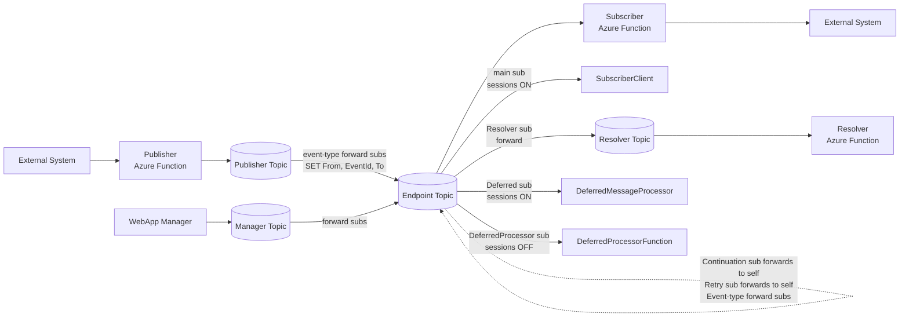

## Topics

| Topic | Purpose | Created by |
|---|---|---|
| `{endpointId}` | One per endpoint (e.g., `storefrontendpoint`, `billingendpoint`). Carries all messages for that endpoint. | Topology provisioner, per endpoint |
| `Resolver` | Central resolution tracking. Receives all response messages. | Topology provisioner, one per platform |
| `Manager` | Management operations. WebApp sends resubmit/skip here. | Topology provisioner, one per platform |

## Subscriptions per Endpoint Topic

Each endpoint topic has these subscriptions:

| Subscription | Sessions | Forward-To | Filter | Action | Consumer |
|---|---|---|---|---|---|
| `{endpointId}` | ON | — | `user.To = '{endpointId}'` | — | **SubscriberClient** (main handler) |
| `Resolver` | OFF | Resolver topic | `user.To = 'Resolver'` | `SET user.From = '{endpointId}'` | (forwarded) |
| `Resolver` (2nd rule) | OFF | Resolver topic | `user.To = '{endpointId}'` | — | (forwarded, for EventRequest tracking) |
| `Continuation` | OFF | self topic | `user.To = 'Continuation'` | `SET user.To = '{endpointId}'; SET user.From = 'Continuation'` | (forwarded back to main sub) |
| `Retry` | OFF | self topic | `user.To = 'Retry'` | `SET user.To = '{endpointId}'; SET user.From = 'Retry'` | (forwarded back to main sub) |
| `Deferred` | ON | — | `user.To = 'Deferred'` | — | **DeferredMessageProcessor** (reads via AcceptSession) |
| `DeferredProcessor` | OFF | — | `user.To = 'DeferredProcessor'` | — | **DeferredProcessorFunction** |
| `{eventTypeId}` | OFF | consuming endpoint topic | `user.EventTypeId = '{eventTypeId}' AND user.MessageType = 'EventRequest' AND user.From IS NULL` | `SET user.From = '{endpointId}'; SET user.EventId = newid(); SET user.To = '{consumerId}'` | (forwarded to consumer) |

### Key Design Points

- **Session-enabled subscriptions** (`{endpointId}`, `Deferred`): guarantee ordered, exclusive delivery per session
- **Forward subscriptions** (`Continuation`, `Retry`): catch messages, rewrite properties, forward back to the same topic — the rewritten `To` then matches the main subscription
- **DeferredProcessor**: NOT session-enabled — it can trigger independently of the main function's session lock
- **Resolver subscription has two rules**: catches both responses (`To = 'Resolver'`) and original EventRequests (`To = '{endpointId}'`) so the Resolver sees the full message history
- **Forwarder rules match only original publishes**: `MessageType = 'EventRequest'` keeps the endpoint's own control traffic about an event (responses, RetryRequest, ProcessDeferredRequest, resubmissions) off the forwarder, and `From IS NULL` keeps forwarded, parked and Manager copies off it

---

## Message Flows

### 1. Happy Path: Publish → Handle → Complete

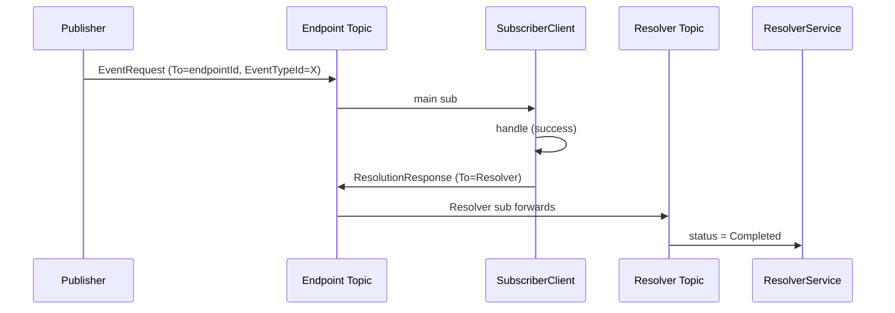

### 2. Handler Failure → Session Blocked

A non-permanent handler exception is wrapped as `EventContextHandlerException`. The session is blocked so siblings defer behind the failed event, the Resolver records `Failed`, and `CheckForRetry` schedules a `RetryRequest` if a policy from `IRetryPolicyProvider` matches the exception. Without a matching policy the event stays Failed until an operator resubmits or skips it.

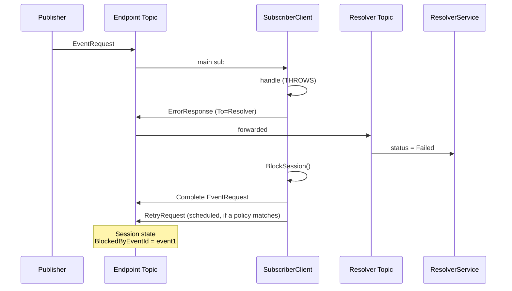

The response, the block, the completion and the retry schedule run to the end even if the receiver stops its processor in the middle of them; see [Settlement and receiver shutdown](#settlement-and-receiver-shutdown).

> See [`error-handling.md`](error-handling.md) for how exception types map to this vs. transient redelivery, immediate dead-letter, or unsupported.

### 3. Deferral: Subsequent Messages on Blocked Session

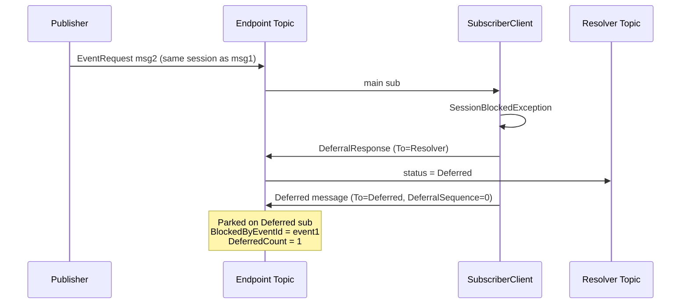

A delivery of the blocking event itself (`EventId` = `BlockedByEventId`) is not parked: it is the redelivery of a message whose earlier delivery blocked the session but was never completed, or a second copy of the event. It is completed without running the handler and without a response, and the block stays with the event; see [A delivery of the blocking event itself](deferred-messages.md#a-delivery-of-the-blocking-event-itself).

### 4. Resubmission → Unblock → Reprocess Deferred

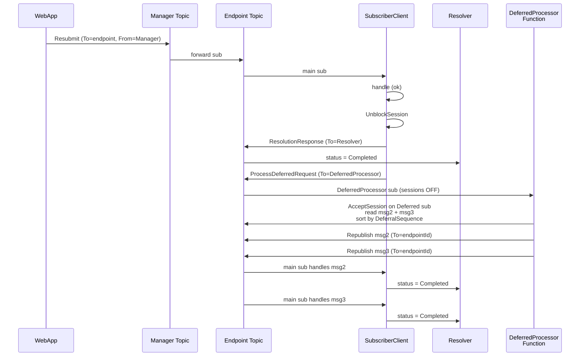

### 5. Skip → Unblock → Reprocess Deferred

Same as resubmission but the failed event is marked as Skipped instead of re-processed:

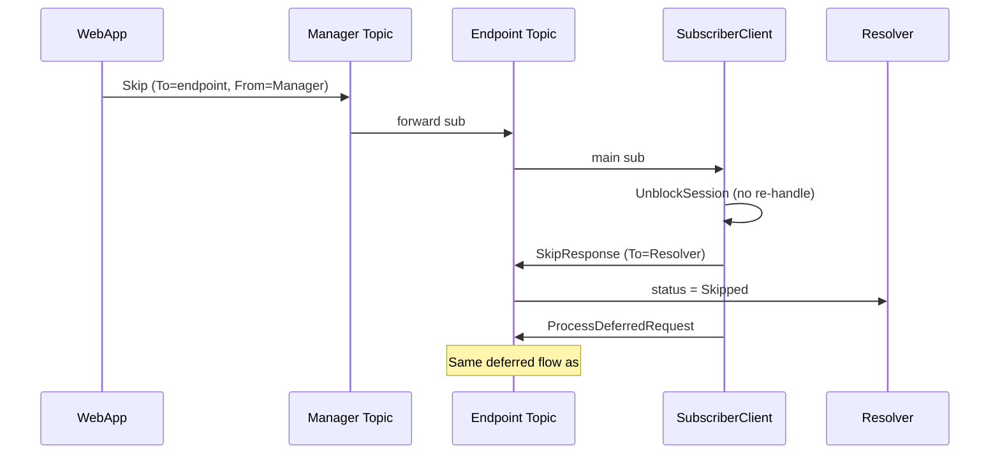

### 6. Retry (Automatic)

When a handler fails and a retry policy matches the exception:

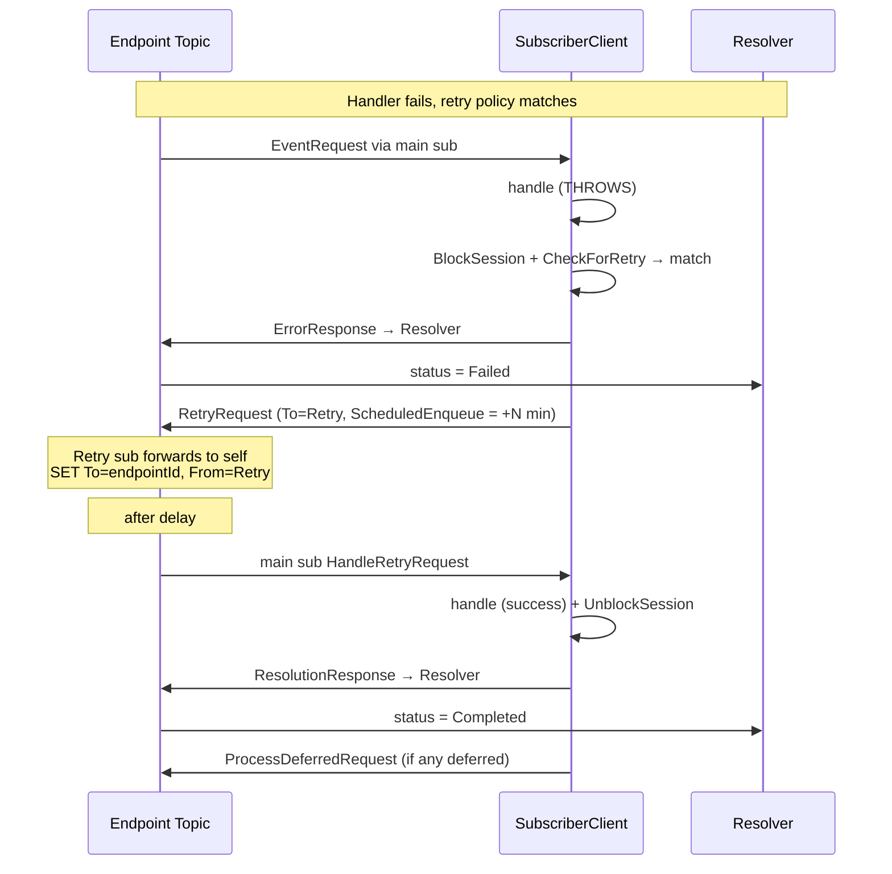

### 7. Continuation (Legacy Deferral)

Removed in v4.0.0. Older versions drained messages parked with the Service Bus defer API
through a `ContinuationRequest` chain; v4 logs and completes any `ContinuationRequest` it
still receives. See [Deferred messages](deferred-messages.md#legacy-service-bus-deferral-removed-in-v400).

### 8. Heartbeat

The platform heartbeat probes an endpoint without any registered handler. The
WebApp scheduler sends straight to the endpoint topic with `From=Manager`; the
SDK answers inside `StrictMessageHandler` before the inbox check and the session
guard; the Resolver diverts the reply to the heartbeat store instead of writing
a tracking record, so heartbeats never reach the Flow or Monitor pages. See
[heartbeat.md](heartbeat.md) for the operator view.

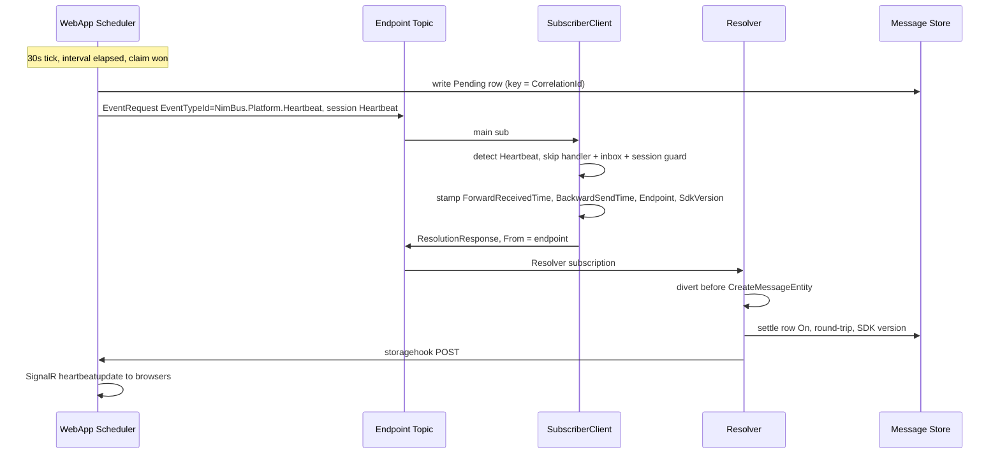

The Resolver liveness probe reuses the same machinery on its own session and
settles itself rather than replying over the bus:

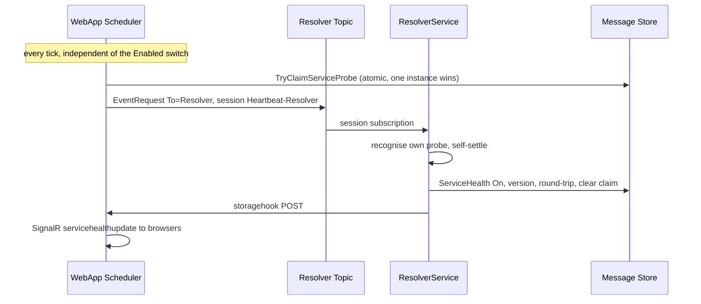

### 9. Unsupported Event Type

No handler registered for the event type:

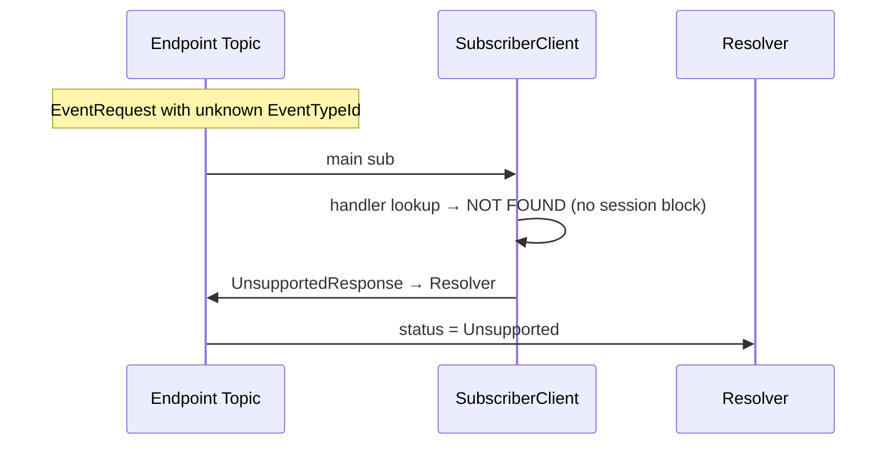

### 10. Event-Type Forwarding (Cross-Endpoint Routing)

How events flow from a producing endpoint to a consuming endpoint:

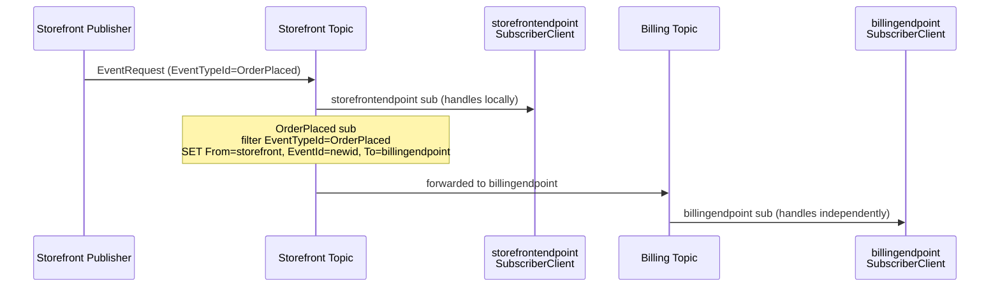

A consumer can also take an event type only for some values of a payload field. The forward rule
then filters on the message's `RoutingKey` property too; see [Routing keys](routing-keys.md).

### 11. Transient Failure → Abandon → Redeliver

When the handler throws `TransientException` (an infrastructure fault where redelivering the identical message is enough, such as a lost session lock), NimBus **does not** call SB Abandon explicitly — `MessageContext.Abandon` is a deliberate no-op. The peek-lock simply expires after ~30 seconds and Service Bus redelivers the same message. No notification is sent to the Resolver, so audit visibility is intentionally minimal for this path. Each attempt counts toward the subscription's max delivery count. Downstream outages and throttling belong on the [scheduled retry](#6-retry-automatic) path instead, through typed exceptions and `AddExceptionRule<T>` (see [error-handling.md](error-handling.md#when-to-throw-what)).

Resolver treats Cosmos DB 429s more deliberately. Scheduled replacements and
broker redeliveries consume one shared ten-attempt budget
(`ThrottleRetryCount + DeliveryCount`). On the final attempt Resolver explicitly
dead-letters with the stable reason `CosmosDbThrottled`; generic storage
transients retain the existing redelivery behavior. If the replacement can't be
scheduled at all (no sender, or the broker refuses it), the original is left for
the session to redeliver instead. Heartbeats never get a scheduled replacement:
a throttled heartbeat is retried in place, because a copy arriving minutes later
could overwrite a newer heartbeat. Owners can inspect and atomically replay
these regular Resolver dead letters from Topology → Subscriptions; a replay keeps
the `MessageId` and drops `ThrottleRetryCount`, so it starts a fresh budget. See
[the subscription incident-response guide](service-bus-subscription-admin.md#replaying-resolver-dead-letters).

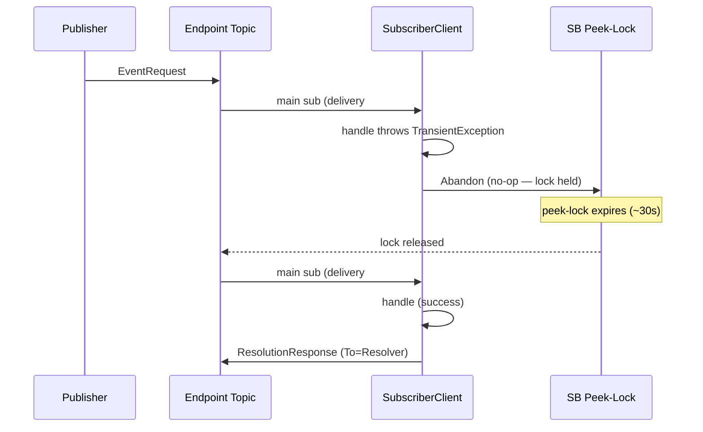

Handlers must be **idempotent** for this to be safe — the same event can be delivered repeatedly until the lock-expiry / max-delivery-count terminal kicks in.

### 12. Dead-letter Routed to Resolver

When `MessageHandler` dead-letters a message (unexpected exception, permanent failure, or middleware-validated dead-letter), it also publishes a notification to the Resolver carrying `DeadLetterReason` and `DeadLetterErrorDescription` as user properties. The Resolver short-circuits on `DeadLetterErrorDescription` and writes the audit record with `ResolutionStatus = DeadLettered`. The actual message still ends up in the Service Bus dead-letter queue — the notification just gives operators a record.

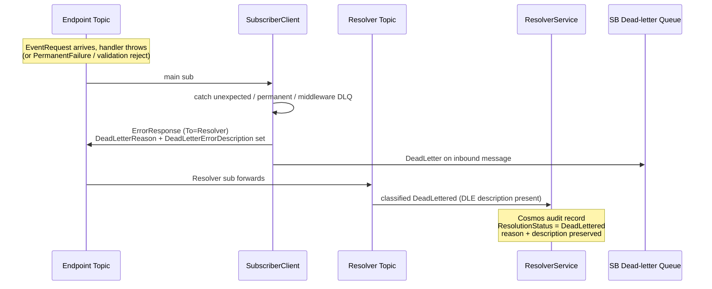

If the notification send fails, the dead-letter still happens — the DLQ remains the source of truth and operators can recover via the Manager.

### 13. PendingHandoff (Async Completion)

The handler hands work off to a long-running external system (e.g. D365 F&O DMF) and signals it via `ctx.MarkPendingHandoff(reason, externalJobId, expectedBy)`. The subscriber sends a `PendingHandoffResponse` to the Resolver, blocks the session so siblings defer in FIFO order, and completes the inbound. Settlement happens later via a `HandoffCompletedRequest` (success) or `HandoffFailedRequest` (failure) issued by the Manager — neither re-invokes the user handler. See [ADR-012](adr/012-pending-handoff.md).

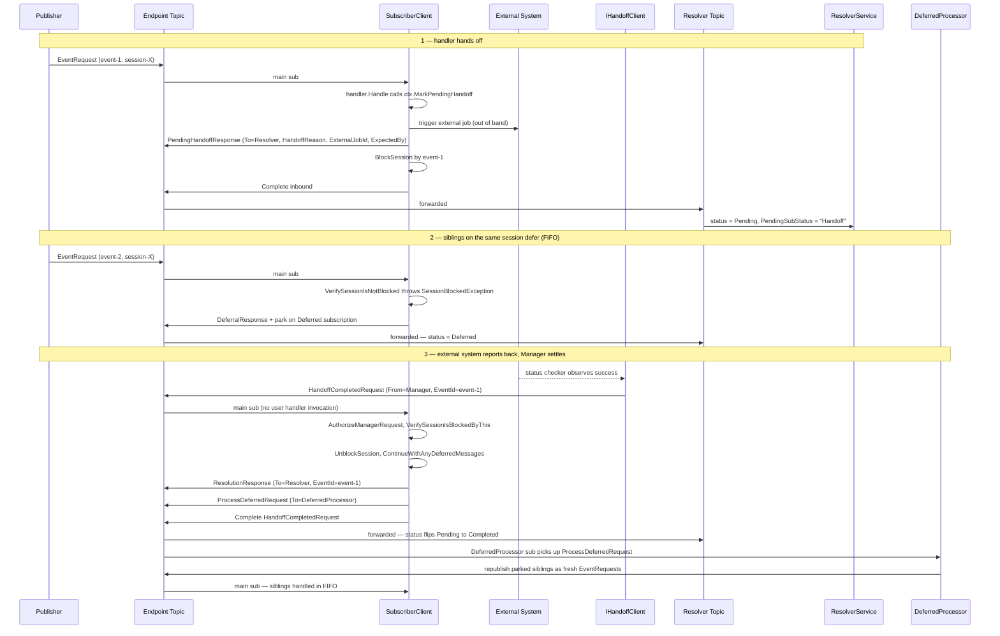

The Resolver projects the `HandoffCompletedRequest` itself as a plain Pending row (the handoff sub-status is cleared) so that the agent zone's non-claiming receive loop stops handing the event out and a second settlement is rejected; the subscriber's `ResolutionResponse` then flips the row to Completed. See the 2026-09-15 note in [ADR-012](adr/012-pending-handoff.md) for why the history-only alternative was not adopted.

The failure path is symmetrical: `IHandoffClient.FailAsync(coords, errorText, errorType)` (which the WebApp's `POST /api/v1/event/handoff/fail/{endpointId}/{eventId}/{messageId}` also calls) issues a `HandoffFailedRequest`, the subscriber's `HandleHandoffFailedRequest` synthesises an `EventContextHandlerException` that wraps a `HandoffFailedException(errorText, errorType)`, sends an `ErrorResponse` to the Resolver (status flips Pending to Failed with `errorText` preserved verbatim), and leaves the session blocked. The operator chooses Resubmit or Skip from the WebApp — both follow today's existing flows.

`MarkPendingHandoff` is idempotent — calling it twice from the same handler invocation overwrites the metadata (last call wins). If the handler calls it AND then throws, the failure path takes precedence: an `ErrorResponse` is sent and the PendingHandoff metadata is discarded.

---

## Settlement and receiver shutdown

A delivery's settlement is everything that follows its outcome: the response to the Resolver, any session-state change (block, unblock, park), the broker completion, and a scheduled `RetryRequest` or `ProcessDeferredRequest`. `StrictMessageHandler` runs it to the end without observing the cancellation token it was handed. That token belongs to the receiver's processor, which cancels it when it stops: on host shutdown, and whenever the [endpoint circuit](circuit-breaker.md) opens. An opening circuit stops deliveries in every session, including sessions whose handlers are healthy. A settlement abandoned half-way leaves state that nothing repairs: an `ErrorResponse` sent and the session blocked, but the message neither completed nor its retry scheduled.

Only the reads that choose a path — the [inbox](inbox-pattern.md) pre-check and the session guards — and the handler itself observe the token. A handler that honours it stops without an outcome, so nothing is settled and the message is redelivered when the receiver restarts. A handler that returned, or failed with anything other than that cancellation, has an outcome, and its delivery settles in full; the inbox records a success under the same rule. Each settlement call stays bounded by the transport's own operation timeout, and the Service Bus processor's `StopProcessingAsync` keeps its receivers open until the in-flight handlers have returned.

A process crash or a lost session lock can still interrupt a settlement. When that happens after the session was blocked, the redelivery finds the session blocked by its own event and is completed without running again; see [A delivery of the blocking event itself](deferred-messages.md#a-delivery-of-the-blocking-event-itself).

---

## Retry Policies

When a handler fails, the `StrictMessageHandler` checks for a matching retry policy via `IRetryPolicyProvider`.

### Backoff Strategies

| Strategy | Delay Calculation | Example (BaseDelay=5s) |
|---|---|---|
| **Fixed** | Always `BaseDelay` | 5s, 5s, 5s, 5s |
| **Linear** | `BaseDelay × (attempt + 1)` | 5s, 10s, 15s, 20s |
| **Exponential** | `BaseDelay × 2^attempt` | 5s, 10s, 20s, 40s |

All strategies respect an optional `MaxDelay` cap.

### Policy Resolution Order

1. **Exception-based rules** — match specific exception types/messages to specific policies
2. **Event-type rules** — match by EventTypeId
3. **Default policy** — fallback if no specific rule matches
4. **No policy** — if no retry policy provider is configured, no retries are attempted

### Configuration

Retry policies are configured via `AddNimBusSubscriber(...).ConfigureRetryPolicies(...)`:

```csharp
services.AddNimBusSubscriber("billingendpoint", sub =>
{
    sub.AddHandler<OrderPlaced, OrderPlacedHandler>()
       .ConfigureRetryPolicies(policies =>
       {
           policies.AddEventTypePolicy("OrderPlaced", new RetryPolicy
           {
               MaxRetries = 3,
               Strategy = BackoffStrategy.Exponential,
               BaseDelay = TimeSpan.FromSeconds(5),
               MaxDelay = TimeSpan.FromMinutes(5)
           });
       });
});
```

**Source:** `src/NimBus.Core/Messages/RetryPolicy.cs`

---

## Session State

Stored in Service Bus session state (JSON serialized):

```json
{
  "BlockedByEventId": "event-guid-or-null",
  "BlockedByMessageId": "message-id-or-null",
  "DeferredSequenceNumbers": [],
  "DeferredCount": 0,
  "NextDeferralSequence": 0
}
```

| Field | Purpose |
|---|---|
| `BlockedByEventId` | Event ID that caused the failure. Prevents other messages in session from processing. |
| `BlockedByMessageId` | Source `MessageId` of the delivery that blocked the session. A successful resubmission records it in the [inbox](inbox-pattern.md#retries-resubmissions-and-deferred-replays). |
| `DeferredSequenceNumbers` | Legacy: sequence numbers of messages deferred within session state |
| `DeferredCount` | New: count of messages sent to the Deferred subscription |
| `NextDeferralSequence` | Counter for ordering deferred messages (FIFO) |

---

## Cosmos DB State Tracking

The Resolver stores every message state change in Cosmos DB:

| Resolution Status | Triggered by | Meaning |
|---|---|---|
| `Pending` | EventRequest, ResubmissionRequest, RetryRequest | Message received, awaiting processing |
| `Completed` | ResolutionResponse | Successfully processed |
| `Failed` | ErrorResponse | Handler threw non-transient exception |
| `Deferred` | DeferralResponse | Session blocked, message parked |
| `Skipped` | SkipResponse | Manager chose to skip this event |
| `Unsupported` | UnsupportedResponse | No handler registered for event type |
| `DeadLettered` | ErrorResponse with DeadLetterReason set | NimBus dead-lettered the message — routed to Resolver alongside the SB DLQ move |

### Which messages may reopen a settled row

The Resolver handles one message at a time per session, but nothing orders the
copies of one event by causality: an auto-forwarded copy can lag, and a message the
store throttled is re-sent on a delay and lands behind whatever is already queued in
its session. So a request copy can arrive *after* the response that settled it.

Since 3.7.0 the store decides, not arrival order (the
[stale-write guard](storage-providers.md#status-writes-the-stale-write-guard)):

- **Control requests** — `ResubmissionRequest`, `SkipRequest`, `RetryRequest`,
  `ContinuationRequest`, `HandoffCompletedRequest`, `HandoffFailedRequest` — are
  operator or manager intent and reopen a settled row, exactly as Resubmit and Skip
  always have. The one exception is a rescheduled or replayed copy of a request the
  row already answers; that is refused.
- **A request copy or a deferral** (`EventRequest`, `DeferralResponse`) only
  refreshes a row that is still in the request stage. It never replaces a settled
  row, a handoff park, or a control request's projection.
- **A handoff park** (`PendingHandoffResponse`) is refused over `Completed` and
  `Skipped` only; `Failed`, `DeadLettered` and `Unsupported` stay open because a
  policy retry parks a handoff straight from a failed row.
- **Terminal writes** are unguarded and always apply.

Two consequences for reading the Flow tab:

- A late fan-out copy, a rescheduled copy and a replayed dead-letter copy all still
  appear there — the per-message history is written before the status write and is
  never guarded. Seeing a request *after* its response is expected; the row's status
  is what tells you the outcome. A refusal is logged by the Resolver
  (`Resolver: Ignored stale ...`), counted as `nimbus.resolver.outcome_ignored`, and
  recorded as a Comment audit on the event.
- A message re-sent after a store throttle keeps its original `MessageId`, so a
  whole throttle chain shares **one** history entry instead of leaving one per round.
  A five-round backoff therefore no longer looks like five request copies.

Rows that a late copy corrupted **before** 3.7.0 still read `Pending`; the guard stops new ones but
repairs none. Repair them from Operations → *Reconcile Stale Pending*, which re-applies the
`ResolutionResponse` the Resolver already stored — see
[the operator guide](stale-pending-reconcile.md).

---

## Design Notes

- `ProcessDeferredRequest` messages are handled by `DeferredProcessorFunction` (a separate Azure Function on the `DeferredProcessor` subscription, sessions=OFF), NOT by `StrictMessageHandler`. This was cleaned up — `StrictMessageHandler.HandleProcessDeferredRequest()` has been removed.
- The `DeferredProcessorFunction` cannot reset the endpoint session state's `DeferredCount` because it runs on a non-session subscription. The stale count is harmless — it only causes a no-op `ProcessDeferredRequest` if a subsequent resubmit/skip occurs on an already-unblocked session.
- All message handlers must be **idempotent** — messages may be redelivered by Service Bus on transient failures.
- **Correlation IDs** are preserved across the entire message chain for distributed tracing via OpenTelemetry.
