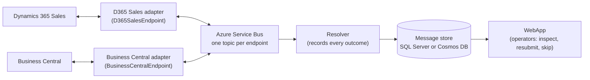

# Onboarding a Customer Project

This guide is for a delivery team starting a customer project on NimBus: developers who know
integration work and the systems being connected, but not NimBus. It uses the most common case —
**Dynamics 365 Sales (Dataverse) and Business Central** exchanging customer and sales data — and
takes you from an empty Azure subscription to adapters running in production.

It does not repeat the reference documentation. Each step says what to do, what to decide, and
which page holds the detail. Read it once end to end, then work through it phase by phase.

| Phase | You end up with |
|---|---|
| [1. Learn the model](#1-the-model-in-ten-minutes) | A shared vocabulary: endpoint, event, catalog, session, Resolver, WebApp, adapter |
| [2. Prerequisites](#2-prerequisites) | Access, identities and tools, requested early because other teams own them |
| [3. Day-one decisions](#3-day-one-decisions) | Storage, hosting, networking, naming and repository layout |
| [4. The catalog](#4-define-the-catalog-endpoints-and-events) | The endpoints and events, published as a versioned contracts package |
| [5. The platform](#5-stand-up-the-platform) | Service Bus, message store, Resolver and WebApp in each environment |
| [6. Local development](#6-develop-locally) | A laptop stack for building and debugging adapters |
| [7. The adapters](#7-build-the-adapters) | A Dynamics 365 adapter and a Business Central adapter |
| [8. Adapter deployment](#8-deploy-the-adapters) | Pipelines that build, test and deploy each adapter |
| [9. Go-live and operations](#9-go-live-and-operations) | Initial sync, monitoring, failure recovery and upgrades |

## 1. The model in ten minutes

NimBus is a set of .NET libraries and two hosted applications on top of **Azure Service Bus**. You
write the adapters; NimBus provides the transport, ordering, the audit trail and the operator
console.



| Term | Meaning |
|---|---|
| **Endpoint** | One participant on the bus, usually one per external system: `D365SalesEndpoint`, `BusinessCentralEndpoint`. Each endpoint gets its own Service Bus topic and subscriptions. |
| **Event** | A C# class deriving from `Event` (for example `D365ProspectUpdated`). Its class name is its `EventTypeId`, which is **global to the Service Bus namespace**: two classes with the same name collide, whatever their namespace. |
| **Catalog (platform)** | A class deriving from `Platform` that lists the endpoints. Each endpoint declares the events it `Produces<T>()` and `Consumes<T>()`. The Service Bus topology and the WebApp's view are both generated from it. |
| **Session key** | The property that orders messages, such as the CRM account id. Messages with the same key are processed one at a time, in order. When one fails, later messages for that key are parked until an operator resubmits or skips the failure. Other keys keep flowing. |
| **Adapter** | Your process for one endpoint. It translates between the system's API and catalog events, publishes changes from its system, and handles events from others. |
| **Resolver** | A NimBus Function App that records the outcome of every message in the message store. You deploy it; you don't change it. |
| **WebApp** | The NimBus management console: message history, failed and parked messages, resubmit and skip, metrics, access control. You deploy it with your catalog. |
| **`nb`** | The NimBus CLI. It provisions the Azure resources, applies the Service Bus topology and deploys the Resolver and WebApp. |

Delivery is **ordered and at-least-once**, not exactly-once: every handler must be idempotent.

Read [architecture.md](architecture.md) for the full picture and [message-flows.md](message-flows.md)
for the flows (publish, failure, resubmit, skip, deferral, request/reply).

### See it working first

Before designing anything, run the [Dynamics 365 Sales ↔ Business Central demo](../samples/DynamicsBcDemo/README.md)
on a laptop. It is the closest thing to your project: simulated CRM and BC systems, two real adapters,
the Resolver and the WebApp, with customer, prospect, opportunity, product-group and quote flows in
both directions. Break a message and recover it in the WebApp. The demo's
[`DynamicsBcDemo.Contracts`](../samples/DynamicsBcDemo/DynamicsBcDemo.Contracts) project is a
complete catalog to copy from.

## 2. Prerequisites

### Where everything comes from

Nothing requires a copy of the NimBus repository ([ADR-015](adr/015-customer-deployment-distribution.md)).

| What | Where | Notes |
|---|---|---|
| Libraries | nuget.org, `Akaule.NimBus.*` | `Akaule.NimBus.SDK` (publish/subscribe), `Akaule.NimBus.Abstractions` (catalog types), `Akaule.NimBus.Inbox.SqlServer`, `Akaule.NimBus.Outbox.SqlServer`, `Akaule.NimBus.Testing`. The assemblies and namespaces are `NimBus.*`. |
| CLI | nuget.org, `Akaule.NimBus.CommandLine` | A .NET tool: `dotnet tool install --global Akaule.NimBus.CommandLine --version <x.y.z>` ([cli.md](cli.md)) |
| Resolver and WebApp | `Akaule.NimBus.Deploy` | Downloaded by `nb deploy apps` for the CLI's own version. You don't build them. |
| Infrastructure templates | Inside the CLI package | The Bicep that `nb infra apply` deploys |
| Local stack | `Akaule.NimBus.AspireHosting` and the tool packages | Service Bus emulator, Resolver and WebApp from packages ([section 6](#6-develop-locally)) |
| Adapter template, patterns and system packs | [NimBus Adapter Kit](https://github.com/akakaule/nimbus-adapter-kit) | `dotnet new nimbus-adapter`, 29 patterns, and Dataverse, Business Central and F&O packs ([section 7](#7-build-the-adapters)) |
| Releases and release notes | [GitHub Releases](https://github.com/context-and-oss/NimBus/releases) | Pick one version for the whole project ([section 9](#upgrading-nimbus)) |

**Use one NimBus version everywhere**: the libraries in every adapter and the contracts package, the
`nb` CLI in every pipeline, and therefore the deployed Resolver and WebApp. Pin it explicitly. Never
install "latest" in a pipeline.

### Request these in week one

Several of these belong to other teams and take time. Start them first.

**Azure**

- [ ] A subscription and one resource group per environment (for example `rg-contoso-int-dev`,
      `-test`, `-prod`).
- [ ] Resource providers registered on the subscription by someone with subscription-level rights:
      `Microsoft.ServiceBus`, `Microsoft.Web`, `Microsoft.Storage`, `Microsoft.Insights`,
      `Microsoft.DocumentDB` (Cosmos DB only), `Microsoft.Sql` (provisioned SQL Server only),
      `Microsoft.EventGrid`. Add `Microsoft.App`, `Microsoft.ContainerRegistry`,
      `Microsoft.KeyVault` and `Microsoft.ManagedIdentity` for the adapters' resources. The full list
      is in [azure-requirements.md](azure-requirements.md#resource-provider-registrations).
- [ ] A deployment identity per environment (an Azure DevOps service connection with workload
      identity federation) with **Owner**, or **Contributor + Role Based Access Control
      Administrator**, on its resource group. Plain Contributor fails, because the templates create
      role assignments ([deployment.md](deployment.md#prerequisites-all-paths)).
- [ ] For private networking only: subnets, a DNS decision and self-hosted agents inside the network
      ([private-networking.md](private-networking.md)).

**Microsoft Entra ID**

- [ ] An app registration for WebApp sign-in, with redirect URI
      `https://<webapp-host>/.auth/login/aad/callback` ([authentication.md](authentication.md#configuration-reference)).
- [ ] The object ids of the first WebApp administrators, or of a security group
      ([authentication.md](authentication.md#authorization-storage-backed-roles-spec-026)).
- [ ] Business Central: an app registration with **Dynamics 365 Business Central →
      `API.ReadWrite.All`** (application permission, admin consent), registered in BC under
      **Microsoft Entra applications** with permission sets. See the
      [Business Central pack](https://github.com/akakaule/nimbus-adapter-kit/blob/main/skills/nimbus-adapter/references/systems/business-central/README.md#authentication)
      for the managed-identity caveats.

**Dynamics 365 / Dataverse**

- [ ] A sandbox environment per non-production environment.
- [ ] An **application user** for each adapter's identity, with a security role scoped to the tables
      the flows touch. The [Dataverse pack](https://github.com/akakaule/nimbus-adapter-kit/blob/main/skills/nimbus-adapter/references/systems/dataverse/README.md#authentication)
      covers the options.
- [ ] Rights to register a plug-in step or Service Endpoint for change detection ([section 7](#change-detection-system--bus)).

**Business Central**

- [ ] A sandbox environment and company per non-production environment.
- [ ] Rights to deploy an AL extension if a flow needs a custom API page (most cross-reference and
      upsert flows do).

**Azure DevOps**

- [ ] A project, with repositories for the contracts, the platform deployment and each adapter
      ([section 3](#repository-layout)).
- [ ] An **Azure Artifacts feed** for the contracts package.
- [ ] Pipeline environments (`dev`, `test`, `prod`) with approvals on test and prod.

### Workstation

| Tool | Version | Used for |
|---|---|---|
| .NET SDK | 10 | Everything |
| Docker Desktop or another container runtime | Current | SQL Server and the local stack |
| Azure CLI | ≥ 2.60 (≥ 2.70 recommended) | Deployments; `nb` refuses older versions for Flex Consumption |
| Bicep CLI | ≥ 0.35.1 | `az bicep upgrade` |
| `nb` | The project's NimBus version | Topology and deployments |
| Node.js | 22 | Only to build NimBus from source; not needed for packages |
| uv and AGR (optional) | Current | Installing the adapter kit's agent skill into an adapter repo |

## 3. Day-one decisions

Record these in a short decision log before the first deployment. Most are hard to change later.

| Decision | Options | Default for this scenario |
|---|---|---|
| **Message store** | Cosmos DB or SQL Server ([storage-providers.md](storage-providers.md)) | SQL Server if the customer's approved stack has no Cosmos DB, or if adapters need SQL anyway (the inbox). `nb` defaults to Cosmos DB, so pass `--storage-provider sqlserver` explicitly. |
| **Solution id and environment names** | Any short lower-case id | Resource names derive from them (`sb-<solution>-<env>`). Choose once. |
| **Network** | Public, or private endpoints with Service Bus Premium | Public unless the customer's policy requires private ([private-networking.md](private-networking.md)) |
| **Resolver hosting** | Flex Consumption or Elastic Premium | Flex Consumption (`nb`'s default) |
| **WebApp sign-in** | Entra ID, or username/password (SQL Server only) | Entra ID ([authentication.md](authentication.md)) |
| **Adapter hosting** | Worker in an Azure Container App, or Azure Functions | Worker in a Container App: what the adapter kit generates, and the only host that supports the circuit breaker ([building-adapters.md](building-adapters.md#how-should-it-be-hosted)) |
| **Endpoints** | One per system, or more | One per system: `D365SalesEndpoint` and `BusinessCentralEndpoint`. Add a second endpoint for a system only for a separate lane, such as bulk loads. |
| **Ownership** | Per entity and per field | Write down which system owns each entity and field (for example: CRM owns prospects and opportunities, BC owns customers and quotes). The demo's [ownership model](../samples/DynamicsBcDemo/README.md#the-ownership-model) is a worked example. |

### Repository layout

The layout that keeps versions and responsibilities clear:

| Repository | Contains | Its pipeline |
|---|---|---|
| `Contoso.Integration.Contracts` | The catalog: the `Platform`, the endpoints and the events. References only `Akaule.NimBus.Abstractions`. | Builds, tests and publishes the NuGet package to the Azure Artifacts feed |
| `Contoso.Integration.Platform` | Pipeline YAML and parameters, no application code | `nb setup` per environment, with the pinned CLI and contracts versions ([section 5](#5-stand-up-the-platform)) |
| `Contoso.D365Sales.Adapter` | The D365 Sales adapter, generated from the kit | Build, test, image, deploy dev → test → prod ([section 8](#8-deploy-the-adapters)) |
| `Contoso.BusinessCentral.Adapter` | The Business Central adapter, generated from the kit | The same |

The adapters consume the contracts **package**, so both always agree on the catalog version. A team
that prefers a single repository can keep the same four parts as folders, with one pipeline each.

## 4. Define the catalog: endpoints and events

The catalog is the integration's contract. Design it with both adapter teams in the room.

### Events

```csharp
using System.ComponentModel;
using System.ComponentModel.DataAnnotations;
using NimBus.Core.Events;

namespace Contoso.Integration.Contracts.D365Sales;

[Description("Published by Dynamics 365 Sales when a prospect is created or a seller changes it.")]
[SessionKey(nameof(AccountId))]
public class D365ProspectUpdated : Event
{
    public static readonly D365ProspectUpdated Example = new()
    {
        AccountId = Guid.Parse("acc00000-0000-4000-8000-000000000105"),
        Name = "Tailspin Marine Research",
        UpdatedAt = new DateTimeOffset(2026, 9, 28, 9, 30, 0, TimeSpan.Zero),
    };

    [Required]
    [Description("The CRM account (accountid). Session key.")]
    public Guid AccountId { get; set; }

    [Required]
    [Description("The account name.")]
    public string Name { get; set; } = "";

    [Description("When the account was created or changed in CRM.")]
    public DateTimeOffset UpdatedAt { get; set; }
}
```

Conventions:

- **Prefix event names with the publishing system** (`D365…`, `Bc…`). The class name is the global
  `EventTypeId`, so prefixes prevent collisions and show who owns the event.
- **Name events as facts** in the past tense (`…Created`, `…Updated`), not as commands to the
  receiver.
- **Choose the session key for each event** from the entity whose changes must stay in order,
  usually the publishing system's record id. Use the same key for every event about that entity.
  See [pattern 02](https://github.com/akakaule/nimbus-adapter-kit/blob/main/skills/nimbus-adapter/references/patterns/02-session-keys.md).
- **Document every event and property** with `[Description]`, mark mandatory fields `[Required]`, and
  provide an `Example`. The WebApp, `nb catalog export` and AsyncAPI export all use them.
- **Carry business data, not the source system's schema.** Map Dataverse columns and BC API fields
  to neutral names in the adapter.

The full conventions, including personal-data marking, are in
[pattern 01](https://github.com/akakaule/nimbus-adapter-kit/blob/main/skills/nimbus-adapter/references/patterns/01-catalog-and-event-conventions.md).

### Endpoints and the platform

```csharp
using Contoso.Integration.Contracts.BusinessCentral;
using Contoso.Integration.Contracts.D365Sales;
using NimBus.Core;
using NimBus.Core.Endpoints;

namespace Contoso.Integration.Contracts;

public class D365SalesEndpoint : Endpoint
{
    public D365SalesEndpoint()
    {
        Produces<D365ProspectUpdated>();
        Consumes<BcCustomerUpdated>();
    }

    public override ISystem System => new D365SalesSystem();

    public override string Description => "Dynamics 365 Sales adapter endpoint.";
}

internal sealed class D365SalesSystem : ISystem
{
    public string SystemId => "D365Sales";
}

public class ContosoPlatform : Platform
{
    public ContosoPlatform()
    {
        AddEndpoint(new D365SalesEndpoint());
        AddEndpoint(new BusinessCentralEndpoint());
    }
}
```

Give every event a producer and at least one consumer. The `Consumes<T>()` declarations become the
Service Bus routing rules: an event that no endpoint declares it consumes is not delivered, even if
an adapter has a handler for it. Synchronous questions, such as a credit check from CRM to BC, use
request/reply; see `D365CreditCheckRequested` in the demo and
[pattern 19](https://github.com/akakaule/nimbus-adapter-kit/blob/main/skills/nimbus-adapter/references/patterns/19-request-reply.md).

### Publish it as a package

The contracts project is a plain class library:

```xml
<Project Sdk="Microsoft.NET.Sdk">
  <PropertyGroup>
    <TargetFramework>net10.0</TargetFramework>
    <PackageId>Contoso.Integration.Contracts</PackageId>
    <Version>1.0.0</Version>
    <GenerateDocumentationFile>true</GenerateDocumentationFile>
  </PropertyGroup>
  <ItemGroup>
    <PackageReference Include="Akaule.NimBus.Abstractions" Version="<nimbus-version>" />
  </ItemGroup>
</Project>
```

Its pipeline runs `dotnet pack` and pushes to the Azure Artifacts feed (with a `NuGetAuthenticate@1`
step before the push). Keep the package's
dependencies to `Akaule.NimBus.Abstractions` and the BCL: `nb` loads the package to provision the
topology and adds its assemblies to the WebApp, without resolving further dependencies.

Version the package deliberately. The catalog **decides the Service Bus routing**, so a new event or
a new `Consumes<T>()` is a new version, rolled out by the platform pipeline before any adapter uses
it.

## 5. Stand up the platform

The platform is the same in every environment and is deployed by `nb setup`. It runs three
layers in order ([deployment.md](deployment.md#what-a-deployment-consists-of)):

1. **Azure resources** (`nb infra apply`): the Service Bus namespace, the message store, Application
   Insights, the Resolver Function App and the WebApp.
2. **Service Bus topology** (`nb topology apply`): topics, session-enabled subscriptions and routing
   rules for every endpoint in your catalog.
3. **Applications** (`nb deploy apps`): the released Resolver, and the WebApp with your catalog added.

### The platform pipeline

The repository's own [`pipelines/azure-pipelines-deploy.yml`](../pipelines/azure-pipelines-deploy.yml)
builds `nb` from a NimBus clone, which suits NimBus developers. A customer platform repository
installs the pinned CLI instead. A minimal stage:

```yaml
parameters:
  - name: environment
    type: string
    values: [dev, test, prod]

variables:
  nimbusVersion: '<x.y.z>'          # the project's NimBus version
  contractsVersion: '<a.b.c>'       # Contoso.Integration.Contracts version to deploy

jobs:
  - deployment: Platform
    environment: contoso-integration-${{ parameters.environment }}
    pool:
      vmImage: ubuntu-latest
    strategy:
      runOnce:
        deploy:
          steps:
            - checkout: self
            - task: UseDotNet@2
              inputs:
                packageType: sdk
                version: 10.0.x
            - script: dotnet tool install --global Akaule.NimBus.CommandLine --version $(nimbusVersion)
              displayName: Install nb
            - task: AzureCLI@2
              displayName: nb setup
              inputs:
                azureSubscription: sc-contoso-integration-${{ parameters.environment }}
                scriptType: bash
                scriptLocation: inlineScript
                inlineScript: |
                  az bicep upgrade
                  nb setup \
                    --solution-id contosoint \
                    --environment ${{ parameters.environment }} \
                    --resource-group rg-contoso-int-${{ parameters.environment }} \
                    --storage-provider sqlserver \
                    --sql-admin-login nimbusadmin \
                    --platform-package Contoso.Integration.Contracts@$(contractsVersion)
              env:
                NIMBUS_SQL_ADMIN_PASSWORD: $(sqlAdminPassword)        # secret variable
                NIMBUS_PLATFORM_FEED: https://pkgs.dev.azure.com/<org>/<project>/_packaging/<feed>/nuget
                NIMBUS_PLATFORM_FEED_TOKEN: $(contractsFeedToken)     # secret: PAT with Packaging (Read)
```

`nb` reads the feed's `/v3/index.json`. Secrets go in environment variables, never on the command
line. Every option, including the SQL variants and private networking, is in
[cli.md](cli.md#nb-infra-apply). Running `nb setup` again is safe: existing resources keep their
region, plan and SKU.

Run it whenever the NimBus version or the contracts version changes. **Topology always goes before
adapter code** that depends on it.

### After the first deployment

- **WebApp sign-in.** Set `AzureAd__TenantId`, `AzureAd__ClientId`, `AzureAd__Domain` (and
  `AzureAd__ClientSecret` for a confidential client) on the WebApp, plus
  `Authorization__AdminUserObjectIds` or `Authorization__AdminGroupObjectIds` for the first
  administrators. Later `nb setup` runs keep these settings ([authentication.md](authentication.md)).
- **Access.** Administrators grant Reader, Contributor or Owner per endpoint on the WebApp's
  **Access Control** page. Payload viewing needs the separate **PII Reader** grant.
- **Check it.** Open the WebApp: both endpoints should be listed with their events.

### Resources the adapters need

`nb` creates only the NimBus platform. The adapter kit's Bicep expects these to **exist in the same
resource group**, so create them with the customer's own infrastructure code:

- a Container Apps environment;
- an Azure Container Registry;
- a Key Vault with the Azure RBAC permission model;
- an integration SQL database for the adapters' inboxes (it can share the server with the message
  store).

## 6. Develop locally

There are two local setups. Use both.

**The adapter's own stack**, generated with the adapter: the adapter, a simulator of the external
system with fault injection, and an Aspire AppHost. It connects to a **Service Bus namespace of the
developer's own** (Standard tier). Never point a local adapter at a namespace a deployed adapter
uses: they compete for the same messages. The template's README explains how to drive the
simulator.

**A full NimBus stack from packages**, to see the audit trail, failures and resubmits in the WebApp:
an AppHost that references `Akaule.NimBus.AspireHosting` and starts the Service Bus emulator, the
topology, the Resolver, the WebApp and your adapters. The complete AppHost is in
[building-adapters.md](building-adapters.md#run-a-local-stack-from-packages).

Develop against the simulator first, then against a CRM and BC sandbox. Most production issues
come from behaviour a simulator doesn't have, such as throttling, update windows and plug-ins firing
on the adapter's own writes. Test against the sandboxes before test.

## 7. Build the adapters

### Generate the adapter

```powershell
git clone https://github.com/akakaule/nimbus-adapter-kit
dotnet new install ./nimbus-adapter-kit/skills/nimbus-adapter/template

dotnet new nimbus-adapter -n Contoso.D365Sales.Adapter --SystemName D365Sales `
  --Contracts package --ContractsPackageId Contoso.Integration.Contracts `
  --ContractsPackageVersion <a.b.c> --PlatformType Contoso.Integration.Contracts.ContosoPlatform `
  --ContractsFeed https://pkgs.dev.azure.com/<org>/<project>/_packaging/<feed>/nuget/v3/index.json `
  --NimBusVersion <x.y.z>
```

`--ContractsFeed` is the feed's full `index.json` URL, as in a `nuget.config`. The platform
pipeline's `NIMBUS_PLATFORM_FEED` is the same URL without `/v3/index.json`.

Do the same for `--SystemName BusinessCentral`. The endpoint name defaults to `<SystemName>Endpoint`
and must equal the endpoint class in the catalog. `--PlatformType` is the platform class's full
name, including its namespace.

The generated solution already has the NimBus wiring, typed client failures, retry rules, a circuit
breaker, an inbox, the simulator, tests, Bicep and an Azure DevOps pipeline. Start from it rather
than from an empty project: it encodes the failures earlier adapters hit in production.

**What package mode leaves out.** With `--Contracts package` the template doesn't generate:

- **The ingress path (system → bus).** `--Ingress true` takes effect only with local contracts, so
  you build the change-notification queue, the re-read and the publish yourself
  ([below](#change-detection-system--bus)). To use the template's ingress code as a reference,
  generate a throwaway copy with `--Contracts local --Ingress true`.
- **Handlers and their tests.** The adapter starts with no handlers. You add one per consumed
  event, with handler and pipeline tests ([Tests](#tests)).

The kit's agent skill can do the same interactively. In Claude Code, Codex or GitHub Copilot, ask it
to "create a NimBus adapter for Business Central", then "add a flow: …" for each flow, and "review
this adapter" before a pull request. Install it as described in the
[kit's README](https://github.com/akakaule/nimbus-adapter-kit#install).

### Design each flow before coding it

For every flow, write down these answers in `docs/flows/<flow>.md` in the adapter repo. The kit's
[flow checklist](https://github.com/akakaule/nimbus-adapter-kit/blob/main/skills/nimbus-adapter/references/checklists/flow-decisions.md)
walks through them.

- the session key and the deterministic `MessageId`;
- the idempotency key on the receiving side (an alternate key in Dataverse, an upstream id field in BC);
- what happens when a referenced record doesn't exist yet;
- which fields the receiver may overwrite;
- how the adapter recognises its own writes when they come back as changes (echo loops).

### Change detection (system → bus)

The pattern for both systems is the same: **the system sends a thin notification to a queue, and
the adapter re-reads the record and publishes it**
([pattern 04](https://github.com/akakaule/nimbus-adapter-kit/blob/main/skills/nimbus-adapter/references/patterns/04-thin-notification-reread.md)).
Don't build event payloads inside the source system. In package mode the template doesn't generate
this path, so each adapter adds it, following the pattern.

| System | Recommended | Alternatives | Detail |
|---|---|---|---|
| Dynamics 365 / Dataverse | An asynchronous post-operation plug-in step or Service Endpoint that sends a notification to a Service Bus queue, filtered on the changed attributes and on the adapter's own user | Webhook, Event Grid, Power Automate, `modifiedon` polling, change tracking | [Dataverse pack: change detection](https://github.com/akakaule/nimbus-adapter-kit/blob/main/skills/nimbus-adapter/references/systems/dataverse/README.md#change-detection-dataverse--bus) |
| Business Central | Webhook subscriptions, received by an HTTP endpoint that answers the validation handshake and enqueues the notification. Subscriptions expire after three days and must be renewed. | Polling on `lastModifiedDateTime` with a stored watermark, or an outbox table in an AL extension | [Business Central pack: change detection](https://github.com/akakaule/nimbus-adapter-kit/blob/main/skills/nimbus-adapter/references/systems/business-central/README.md#change-detection-bc--bus) |

Plan the **initial sync** (existing customers and contacts at go-live) as a flow of its own
([pattern 09](https://github.com/akakaule/nimbus-adapter-kit/blob/main/skills/nimbus-adapter/references/patterns/09-initial-and-bulk-sync.md)).

### Writing (bus → system)

- Upsert on a key that survives retries: an alternate key in Dataverse, a custom API page keyed on
  the upstream id in BC ([pattern 12](https://github.com/akakaule/nimbus-adapter-kit/blob/main/skills/nimbus-adapter/references/patterns/12-idempotent-upsert.md)).
- Read before writing, and write only the fields the receiver owns and that actually changed. This
  also stops most echo loops ([pattern 16](https://github.com/akakaule/nimbus-adapter-kit/blob/main/skills/nimbus-adapter/references/patterns/16-field-ownership-and-outcomes.md),
  [pattern 08](https://github.com/akakaule/nimbus-adapter-kit/blob/main/skills/nimbus-adapter/references/patterns/08-echo-loop-prevention.md)).
- Store the other system's id on the record you write, so later events can find it
  ([pattern 13](https://github.com/akakaule/nimbus-adapter-kit/blob/main/skills/nimbus-adapter/references/patterns/13-cross-references-and-id-writeback.md)).

### Failures and retries

Classify every failure where the external system is called. Throttling (429), timeouts and update
windows (503) are transient and retried with backoff. Validation errors and missing data are
permanent: they fail at once and appear in the WebApp for an operator. Keep HTTP-level retries off
the client so every attempt fits inside the message lock. The generated adapter does all of this;
[building-adapters.md § Resilience](building-adapters.md#resilience) and the kit's
[patterns 20–23](https://github.com/akakaule/nimbus-adapter-kit/blob/main/skills/nimbus-adapter/references/patterns/README.md)
explain why.

### Tests

The template's tests cover client classification, retry rules, the circuit breaker, the catalog and
the wiring. In package mode it has no handler or pipeline tests: write them for each flow you add.

The architecture test compares the handlers with the endpoint's `Consumes<T>()` declarations. In
package mode it reports **inconclusive** while the adapter has no handlers at all, and lists the
events still to build. From the first handler on, it fails on any mismatch. Don't deploy an adapter
while that test is inconclusive. See
[building-adapters.md § Adapter testing](building-adapters.md#adapter-testing).

Before an adapter goes to test, work through the kit's
[review checklist](https://github.com/akakaule/nimbus-adapter-kit/blob/main/skills/nimbus-adapter/references/checklists/review.md)
and the [production checklist](building-adapters.md#production-checklist).

## 8. Deploy the adapters

Each generated adapter has an `azure-pipelines.yml`. Pull requests build and test only. `main` also
builds a container image and deploys `deploy/main.bicep` to dev, test and prod, waiting for the
approvals on each pipeline environment.

**Topology has one owner.** In package mode the adapter pipeline doesn't apply the topology: the
platform pipeline does, from the same contracts package ([section 5](#5-stand-up-the-platform)). So
the release order is always: contracts package → platform pipeline → adapters. (In local-contracts
mode the adapter pipeline applies its own catalog before deploying.)

The template's README lists the one-time setup. In short:

1. Fill in the placeholders in `azure-pipelines.yml` and `deploy/main.<env>.bicepparam`.
2. **Authenticate to the contracts feed.** The generated `NuGet.config` restores the contracts
   package from your Azure Artifacts feed, but the generated pipeline has no credential step. Add a
   `NuGetAuthenticate@1` task before the build, and in the job that publishes the container image.
   Give the pipeline's build service read access to the feed.
3. Create a service connection per environment with **Contributor + Role Based Access Control
   Administrator** on the resource group, because the Bicep creates the adapter's managed identity and
   its role assignments.
4. After the first deployment, give the adapter's managed identity (the `identityPrincipalId`
   output) access to its system: an application user in Dataverse, or the BC setup described in the
   Business Central pack.
5. **Prepare the inbox database.**
   - Store its connection string in the Key Vault under the secret name the Bicep expects
     (`integration-db-connection-string` by default).
   - The inbox creates its table on first use, so the database user needs permission to create it
     once. Otherwise create the table up front and set `AutoCreateTable` to false.
   - Managed-identity SQL authentication with SqlClient 7 also needs the
     `Microsoft.Data.SqlClient.Extensions.Azure` package.

Details: the kit's [pattern 28](https://github.com/akakaule/nimbus-adapter-kit/blob/main/skills/nimbus-adapter/references/patterns/28-deploy-and-pipeline.md).
Adapters on Azure Functions instead: [azure-functions-hosting.md](azure-functions-hosting.md).

## 9. Go-live and operations

### Before go-live

- [ ] The initial sync has run in test against production-sized data, and its duration is known.
- [ ] `MaxConcurrentSessions` and the replica counts are sized to what Dataverse and BC tolerate
      ([throughput-tuning.md](throughput-tuning.md)).
- [ ] Alerts exist on the circuit-breaker log line (`Circuit for <Endpoint> opened`), on failed
      messages and on heartbeat gaps ([heartbeat.md](heartbeat.md), [notifications.md](notifications.md)).
- [ ] Operators have their WebApp roles and have practised resubmit and skip in test.
- [ ] BC webhook renewal is running, and copied BC environments have their webhooks re-created.
- [ ] Every adapter, the contracts package and the platform run the same NimBus version.

### Operating

A failed message shows in the WebApp with its error. The failed message blocks its session, and
later messages for the same key are parked behind it. The operator fixes the cause, usually data in
CRM or BC, then:

- **Resubmit** to process it again; the parked messages follow in order.
- **Skip** when it no longer matters; the parked messages are then processed.

See [webapp-failed-messages.md](webapp-failed-messages.md), [deferred-messages.md](deferred-messages.md)
and [error-handling.md](error-handling.md). On Cosmos DB, the `nb container` commands handle bulk
resubmit, skip and clean-up ([cli.md](cli.md#nb-container-resubmit)). They work on Cosmos DB only.
On SQL Server, recover failures from the WebApp.

### Upgrading NimBus

Read the release notes of every version between yours and the target. Then, in this order:

1. Update the NimBus version in the contracts package, build it and publish a new package version.
2. Update `nimbusVersion` and `contractsVersion` in the platform pipeline and run it in dev.
3. Update the NimBus version in each adapter (`Directory.Packages.props` and `azure-pipelines.yml`),
   build in Release, run the tests and deploy.
4. Promote to test and prod in the same order.

Patch releases contain fixes only. Minor and major releases are described in
[versioning.md](versioning.md).

## Reading list

| When | Read |
|---|---|
| First day | This guide, [README](../README.md), [architecture.md](architecture.md), the [Dynamics 365 ↔ BC demo](../samples/DynamicsBcDemo/README.md) |
| Designing the catalog | [getting-started.md](getting-started.md), [message-flows.md](message-flows.md), [sdk-api-reference.md](sdk-api-reference.md), kit patterns 01–03 |
| Setting up environments | [deployment.md](deployment.md), [azure-requirements.md](azure-requirements.md), [cli.md](cli.md), [authentication.md](authentication.md), [storage-providers.md](storage-providers.md) |
| Building adapters | [building-adapters.md](building-adapters.md), the kit's [patterns](https://github.com/akakaule/nimbus-adapter-kit/blob/main/skills/nimbus-adapter/references/patterns/README.md) and the Dataverse and Business Central packs |
| Before go-live | [throughput-tuning.md](throughput-tuning.md), [error-handling.md](error-handling.md), [deferred-messages.md](deferred-messages.md), [private-networking.md](private-networking.md) |
