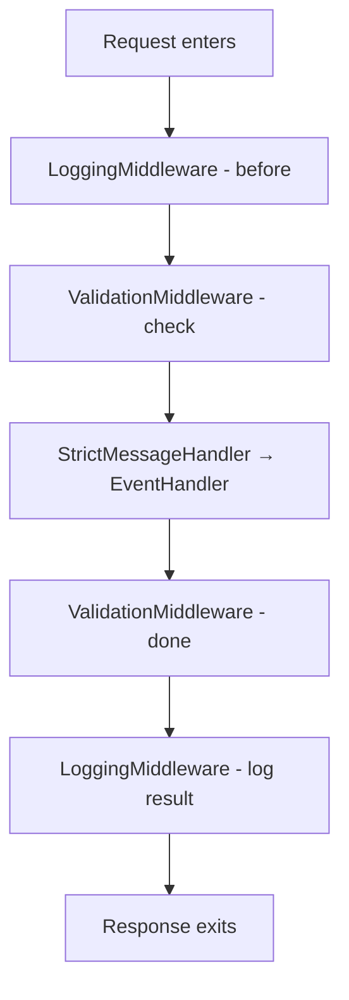

# Pipeline Middleware

NimBus includes a middleware pipeline that wraps message processing, allowing cross-cutting concerns like logging, metrics, validation, and error enrichment without modifying handler code.

## How It Works

Middleware behaviors implement `IMessagePipelineBehavior` and execute in registration order, each wrapping the next. The innermost step is the actual message handler (`StrictMessageHandler`).



Each behavior receives the full `IMessageContext` and a `next` delegate. Calling `await next(context, ct)` passes control to the next behavior (or the terminal handler). Not calling `next` short-circuits the pipeline.

## Registration

Register middleware via `AddNimBus()` before `AddNimBusSubscriber()`:

```csharp
builder.Services.AddNimBus(nimbus =>
{
    nimbus.AddPipelineBehavior<LoggingMiddleware>();
    nimbus.AddPipelineBehavior<ValidationMiddleware>();
});

builder.Services.AddNimBusSubscriber("BillingEndpoint", sub =>
{
    sub.AddHandler<OrderPlaced, OrderPlacedHandler>();
});
```

Behaviors execute in registration order — first registered is outermost (executes first on the way in, last on the way out).

> **Consumer span + metrics are not a pipeline behavior.** The `NimBus.Process` span and the `nimbus.message.received` / `processed` / `process.duration` instruments are owned by the transport adapter (`ServiceBusAdapter` → `NimBusConsumerInstrumentation`). Every subscriber path gets them — including direct `SubscriberClient.CreateAsync` callers and hosts that never registered `AddNimBus(...)` at all — so there is no `MetricsMiddleware` to register. See `src/NimBus.Core/Diagnostics/NimBusConsumerInstrumentation.cs`.

## Built-in Middleware

### Endpoint circuit breaker

`WithCircuitBreaker(...)` appends a recorder around terminal handler dispatch. It records retry/transient outcomes without changing exception or settlement semantics. When the configured rate opens the circuit, the SDK stops the endpoint's hosted receivers instead of abandoning messages. See [`circuit-breaker.md`](circuit-breaker.md) for configuration, counting rules, half-open concurrency, telemetry, and the Azure Functions limitation.

### LoggingMiddleware

Logs message processing with timing, event metadata, and outcome via `Microsoft.Extensions.Logging`.

**Output on success:**
```
info: Processing EventRequest | EventType=OrderPlaced EventId=abc-123 SessionId=session-001
info: Completed EventRequest in 42ms | EventType=OrderPlaced EventId=abc-123
```

**Output on failure:**
```
info: Processing EventRequest | EventType=OrderPlaced EventId=abc-123 SessionId=session-001
fail: Failed EventRequest after 3ms | EventType=OrderPlaced EventId=abc-123
```

**Source:** `src/NimBus.Core/Pipeline/LoggingMiddleware.cs`

### Consumer instrumentation (not a middleware)

Message processing metrics and the `NimBus.Process` span are emitted by the transport adapter, not by a pipeline behavior. The relevant instruments are on the `NimBus.Consumer` meter:

| Metric | Type | Unit | Tags |
|--------|------|------|------|
| `nimbus.message.received` | Counter | messages | `messaging.system`, `messaging.destination.name`, `nimbus.event_type` |
| `nimbus.message.processed` | Counter | messages | `messaging.system`, `messaging.destination.name`, `nimbus.event_type`, `nimbus.outcome` |
| `nimbus.message.process.duration` | Histogram | ms | same as `processed`, with `error.type` on failure |

Wire these via `AddNimBusInstrumentation()` (see `docs/observability.md` — pending) or directly:

```csharp
builder.Services.AddOpenTelemetry()
    .WithMetrics(metrics => metrics.AddMeter("NimBus.Consumer"));
```

**Source:** `src/NimBus.Core/Diagnostics/NimBusConsumerInstrumentation.cs`

### ValidationMiddleware

Validates message context before processing. Dead-letters messages that fail validation:

- Messages without an `EventId` are dead-lettered
- `EventRequest` messages without an `EventTypeId` are dead-lettered
- All other messages pass through

**Source:** `src/NimBus.Core/Pipeline/ValidationMiddleware.cs`

## Writing Custom Middleware

Implement `IMessagePipelineBehavior`:

```csharp
using NimBus.Core.Extensions;
using NimBus.Core.Messages;

public class TimingBehavior : IMessagePipelineBehavior
{
    private readonly ILogger<TimingBehavior> _logger;

    public TimingBehavior(ILogger<TimingBehavior> logger)
    {
        _logger = logger;
    }

    public async Task Handle(
        IMessageContext context,
        MessagePipelineDelegate next,
        CancellationToken cancellationToken = default)
    {
        var sw = Stopwatch.StartNew();

        await next(context, cancellationToken);

        sw.Stop();
        if (sw.ElapsedMilliseconds > 1000)
        {
            _logger.LogWarning("Slow message: {EventTypeId} took {ElapsedMs}ms",
                context.EventTypeId, sw.ElapsedMilliseconds);
        }
    }
}
```

Register it:
```csharp
builder.Services.AddNimBus(nimbus =>
{
    nimbus.AddPipelineBehavior<TimingBehavior>();
});
```

Middleware is resolved from DI, so constructor injection works for any registered service.

## Common Patterns

### Exception Handling

For the full classification of how each exception type is handled (transient redelivery, retry, dead-letter), see [`error-handling.md`](error-handling.md).

Wrap `next()` in try/catch to observe or transform exceptions:

```csharp
public async Task Handle(IMessageContext context, MessagePipelineDelegate next, CancellationToken ct)
{
    try
    {
        await next(context, ct);
    }
    catch (SqlException ex) when (ex.IsTransient)
    {
        // A blip in the adapter's own database: redeliver the identical message.
        throw new TransientException("Integration database unavailable — redelivering", ex);
    }
}
```

`TransientException` abandons the message after a short backoff and releases
its session, so Service Bus redelivers it before the rest of the session, with
no audit record and no retry policy. Use it for
infrastructure faults like this one. For a slow or failing downstream API,
throw a typed exception from the client and retry it with
`AddExceptionRule<T>` instead; see
[error-handling.md](error-handling.md#when-to-throw-what).

### Short-Circuiting

Skip processing by not calling `next()`:

```csharp
public async Task Handle(IMessageContext context, MessagePipelineDelegate next, CancellationToken ct)
{
    if (context.EventTypeId == "DeprecatedEvent")
    {
        await context.Complete(ct);  // Acknowledge without processing
        return;
    }

    await next(context, ct);
}
```

### Conditional Middleware

Apply logic only for specific message types:

```csharp
public async Task Handle(IMessageContext context, MessagePipelineDelegate next, CancellationToken ct)
{
    if (context.MessageType == MessageType.EventRequest)
    {
        // Only apply to event requests, not retries/resubmissions
        ValidatePayload(context);
    }

    await next(context, ct);
}
```

### Enriching Context

Add correlation data for downstream processing:

```csharp
public async Task Handle(IMessageContext context, MessagePipelineDelegate next, CancellationToken ct)
{
    using var scope = _logger.BeginScope(new Dictionary<string, object>
    {
        ["EventId"] = context.EventId,
        ["SessionId"] = context.SessionId,
        ["CorrelationId"] = context.CorrelationId,
    });

    await next(context, ct);
}
```

## Lifecycle Observers

For passive observation without modifying the pipeline flow, use `IMessageLifecycleObserver`:

```csharp
public class AlertingObserver : IMessageLifecycleObserver
{
    public Task OnMessageReceived(MessageLifecycleContext context, CancellationToken ct) => Task.CompletedTask;
    public Task OnMessageCompleted(MessageLifecycleContext context, CancellationToken ct) => Task.CompletedTask;

    public Task OnMessageFailed(MessageLifecycleContext context, Exception ex, CancellationToken ct)
    {
        // Send alert on failure
        return SendAlert($"Message {context.EventId} failed: {ex.Message}");
    }

    public Task OnMessageDeadLettered(MessageLifecycleContext context, string reason, Exception ex, CancellationToken ct)
    {
        // Send critical alert on dead-letter
        return SendCriticalAlert($"Message {context.EventId} dead-lettered: {reason}");
    }
}
```

Register via:
```csharp
builder.Services.AddNimBus(nimbus =>
{
    nimbus.AddLifecycleObserver<AlertingObserver>();
});
```

Observers fire automatically — `OnMessageReceived` before the pipeline, `OnMessageCompleted`/`OnMessageFailed` after, `OnMessageDeadLettered` when a message is moved to the dead-letter queue, and `OnCircuitStateChanged` for endpoint breaker transitions.

## IMessageContext — Available Data

Middleware has access to the full message context:

| Property | Type | Description |
|----------|------|-------------|
| `EventId` | string | Unique event identifier |
| `MessageId` | string | Unique message identifier |
| `EventTypeId` | string | Event type name (e.g., "OrderPlaced") |
| `MessageType` | MessageType | Enum: EventRequest, RetryRequest, ResubmissionRequest, etc. |
| `SessionId` | string | Session identifier for ordered processing |
| `CorrelationId` | string | Correlation tracking across message chains |
| `From` | string | Sender endpoint |
| `To` | string | Receiver endpoint |
| `EnqueuedTimeUtc` | DateTime | When message was enqueued |
| `RetryCount` | int? | Current retry attempt number |
| `MessageContent` | MessageContent | Event payload and error content |
| `HandlerOutcome` | HandlerOutcome | How handler dispatch ended: `Default`, `PendingHandoff`, `DuplicateDetected` or `NotDispatched` (answered without running a handler); read it after `next` returns |
| `HandledFailure` | Exception? | Failure the handler settled without rethrowing (a failed RetryRequest or ResubmissionRequest, or a discarded failure); read it after `next` returns |

Control methods: `Complete()`, `Abandon()`, `DeadLetter()`, `Defer()`, `BlockSession()`, `UnblockSession()`.

## Key Source Files

| Component | File |
|-----------|------|
| `IMessagePipelineBehavior` | `src/NimBus.Core/Extensions/IMessagePipelineBehavior.cs` |
| `MessagePipeline` | `src/NimBus.Core/Extensions/MessagePipeline.cs` |
| `IMessageLifecycleObserver` | `src/NimBus.Core/Extensions/IMessageLifecycleObserver.cs` |
| `NimBusBuilder` | `src/NimBus.Core/Extensions/NimBusBuilder.cs` |
| `LoggingMiddleware` | `src/NimBus.Core/Pipeline/LoggingMiddleware.cs` |
| Consumer instrumentation (transport adapter) | `src/NimBus.Core/Diagnostics/NimBusConsumerInstrumentation.cs` |
| `ValidationMiddleware` | `src/NimBus.Core/Pipeline/ValidationMiddleware.cs` |
| Pipeline wiring in SDK | `src/NimBus.SDK/Extensions/ServiceCollectionExtensions.cs` |

## Test Coverage

| Test File | Tests | What's Covered |
|-----------|-------|---------------|
| `NimBus.Core.Tests/ExtensionFrameworkTests.cs` | 10 | Pipeline execution order, short-circuit, no-behaviors, lifecycle notifier, NimBusBuilder registration |
| `NimBus.Core.Tests/BuiltInMiddlewareTests.cs` | LoggingMiddleware, ValidationMiddleware, Pipeline wiring |
| `NimBus.EndToEnd.Tests/PipelineAndLifecycleTests.cs` | 9 | Full pipeline E2E: behavior wrapping, multi-behavior order, short-circuit, lifecycle events, dead-letter, exception swallowing |
