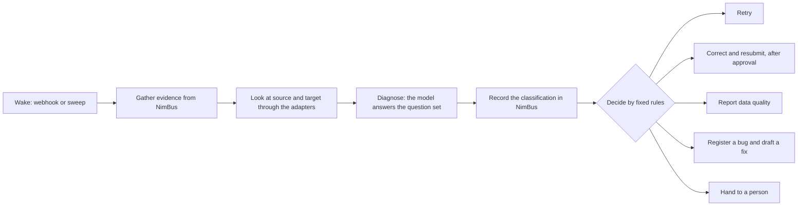
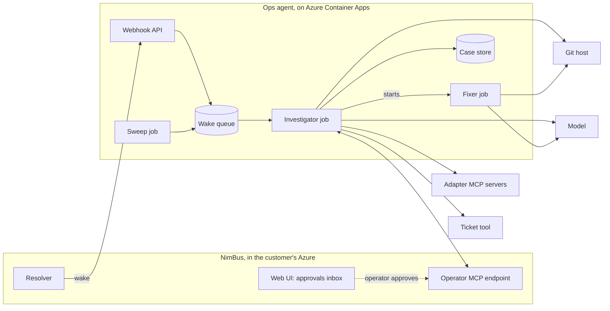

# Spec 051 — The NimBus ops agent

Status: proposed (2026-11-15). Not yet approved; nothing in it is built.
Baseline: master `24bf3aa6`; the latest release is v4.17.0.
Builds on [Spec 035](../035-mcp-operator-access/spec.md),
[Spec 037](../037-mcp-admin-access/spec.md),
[Spec 044](../044-agent-first/spec.md) and
[Spec 046](../046-mcp-guided-actions/spec.md).

This spec designs an agent that operates NimBus for failed messages: it analyses each new failure,
finds the cause, and resubmits, corrects, reports or drafts a fix. It has two parts with different
homes:

- **The ops agent**, a service in a repository of its own, deployed by the customer (§6 to §9).
- **Four additions to NimBus** that the agent needs (§10). Each is its own change in this
  repository, with its own plan.

Spec 044 stays in force: NimBus calls no model, holds no repository or tracker credentials and
hosts no agent. The ops agent is a caller of the operator MCP endpoint, like the
[failure agent](../../failure-agent.md) reference runner, which stays as the minimal sample.

## 1. What the agent does

When it is triggered, the agent takes the failed and dead-lettered messages that have no
classification yet and works each one to one of five outcomes.

| # | Outcome | When | What the agent does | Who decides |
|---|---|---|---|---|
| 1 | **Retry** | The cause is temporary | Resubmits within its budget and reads the result back | The agent |
| 2 | **Correct and resubmit** | The source sent wrong data and the right value is known from the source or target system | Proposes a change to named fields; after approval NimBus resubmits the changed message. It also opens a data-quality ticket so the source is fixed | A person approves |
| 3 | **Report data quality** | The source sent wrong data and only its owner can fix it | Opens a ticket in the source owner's tool and links the failures to it | The agent |
| 4 | **Register a bug and draft a fix** | The adapter's code is wrong | Opens an issue in the adapter's repository and a draft pull request with a regression test. After the fix ships it resubmits the linked failures | Reviewers merge |
| 5 | **Hand to a person** | Anything else, or the agent is not sure enough | Leaves its classification and rationale | A person |

Outcomes 1, 3, 4 and 5 are those of Spec 044. Outcome 2 is new, and so are two things the agent
does on the way: it is woken by NimBus when a failure occurs, and it looks at the data in the source
and target systems before it decides.

## 2. Decisions

Taken with the user in an interview on 2026-11-15.

| Topic | Decision |
|---|---|
| Runtime | A custom service, not a managed agent platform and not the scheduled CLI runner |
| Framework | .NET with Microsoft Agent Framework. The code fix runs as a separate sandboxed step with a headless coding agent |
| Hosting | Azure Container Apps in the customer's subscription: one app for the webhook, jobs for the work |
| Trigger | A webhook from NimBus when a failure occurs, plus a scheduled sweep |
| Model | The customer's choice. The reference setup uses Claude |
| Source and target data | Through each adapter's read-only MCP server, found through the address NimBus keeps on the endpoint |
| Approval | An approval inbox in the NimBus Web UI, with a notification in Teams |
| Autonomy | Plain resubmit runs unattended within the budget NimBus enforces. Resubmit with changes always needs a person |
| Data-quality tickets | In the source owner's own tool, through a pluggable ticket port. The first version ships one connector and a webhook or e-mail fallback |
| Bugs and fixes | Issues and pull requests in the adapter's Git repository, GitHub or Azure DevOps |
| Repository | The agent lives in a repository of its own |

## 3. Principles

1. **The model finds and proposes. Code decides and acts.** The model reads evidence and returns a
   structured diagnosis. Which outcome follows, and every call that changes a message, a ticket or
   a repository, is made by the service's code under fixed rules (§7.5).
2. **NimBus is the record.** The classification, the reported marker, the ticket link, the approval
   and every resubmit live in NimBus, with its audit trail. The agent's own store holds only what it
   needs to resume a case.
3. **Everything read is untrusted.** Error text, payloads, adapter answers and ticket text are data.
   Nothing in them is followed as an instruction.
4. **The agent sees no more than a person in its role would.** Payloads reach it redacted. A
   correction is sent as a patch, so the agent never needs the full payload (§10.2).
5. **People decide what changes business data and what ships.** A corrected resubmit needs an
   operator. A pull request needs reviewers; the agent's token cannot merge.

## 4. What exists and what is missing

Checked against the baseline.

| Step | Exists in v4.17.0 | Missing |
|---|---|---|
| Know that a failure happened | The Resolver mails endpoint alert subscribers on a Failed or DeadLettered outcome. `webhook` subscriptions are stored but not delivered | Delivery to a webhook (§10.1) |
| Find the new failures | `nimbus_get_worklist`, `nimbus_find_messages` with `includeClassification` | Nothing |
| Read the evidence | `nimbus_get_failure_evidence`: scrubbed error, history, sender, redacted payload and stack trace behind Owner switches, the question set | Nothing |
| Look at the source and target systems | Nothing | An address for each adapter's MCP server (§10.3) and the server itself (§10.4) |
| Record the diagnosis | `nimbus_record_classification`, question set version 2 with fault origin | Nothing |
| Retry | `nimbus_prepare_action`, `nimbus_resubmit_message`, `nimbus_get_operation`; unattended within a budget of 20 a day and a cap of 2 per message by default | Nothing |
| Correct and resubmit | Resubmit with changes in the Web UI and REST (`post-resubmit-with-changes-event-ids`), for a signed-in person | A way for an agent to propose it and a person to approve it (§10.2) |
| Report data quality | `nimbus_set_message_reported` with a ticket id, `nimbus_find_reports`, owner and source system on `nimbus_get_endpoint` | A connector to the owner's ticket tool, in the agent (§8.3) |
| Register a bug, draft a fix | Repository address and ticket link on the endpoint; resubmit by ticket | Nothing in NimBus |

## 5. How one failure is handled

1. **Wake.** A webhook names an endpoint, or the sweep names every endpoint the agent can read.
   Either one only says "look"; it carries no work item.
2. **Gather.** The agent lists failed and dead-lettered messages on the endpoint that have no
   classification, groups them by event type and error pattern, and reads the evidence of the newest
   message in each group. It reads `nimbus_find_reports` to see whether the pattern already has a
   ticket.
3. **Look at the systems.** Where the sending or the receiving endpoint lists an adapter MCP
   address, the agent reads the record the message is about, the mapping the adapter applies and the
   target system's last answer (§10.4).
4. **Diagnose.** The model answers the question set and, where it sees one, proposes a correction
   (§7.4).
5. **Record.** The agent records the classification with `nimbus_record_classification`. NimBus
   composes the guidance.
6. **Decide and act.** The rules of §7.5 pick the outcome. The agent carries it out and reads the
   result back.

A case that waits for a person, or for a fix to ship, is saved and picked up again by a later wake.

## 6. Architecture

| Part | What it is | What it does |
|---|---|---|
| Webhook API | A small ASP.NET Core app, always reachable | Verifies the signature of a wake-up (§10.1), drops duplicates for the same endpoint inside a short window and puts the endpoint on the wake queue |
| Sweep job | A Container Apps job on a timer, every 30 minutes by default | Puts every readable endpoint on the wake queue, so a missed webhook delays a failure and does not lose it. It also re-checks waiting cases |
| Wake queue | An Azure Storage queue | Decouples the webhook from the work and scales the investigator from zero |
| Investigator job | A Container Apps job started by the queue | Runs the flow of §5 for one endpoint. Holds the NimBus workload identity |
| Fixer job | A Container Apps job started per bug | Clones the adapter's repository in a fresh container and runs the coding agent (§9). Holds the Git credential and no NimBus role that changes a message |
| Case store | Azure Table storage and a blob container for workflow checkpoints | Holds case ids, states and the run log. No payload values |

The agent has no user interface of its own. Operators see its work in NimBus: classifications on the
message, the approvals inbox, the audit trail and the MCP activity log.

## 7. The investigator

### 7.1 Framework

- The investigator is a Microsoft Agent Framework workflow: one executor per step of §5, with a
  checkpoint after each step that changes something outside the agent. A case that fails halfway
  resumes at the last checkpoint.
- The model is reached through `IChatClient` from `Microsoft.Extensions.AI`, so a deployment can
  choose its provider. The reference setup uses the Anthropic C# SDK with `claude-opus-5-5`, direct
  or through Microsoft Foundry. Effort is set explicitly, and a refusal is treated as "hand to a
  person".
- The diagnosis is requested as structured output against a JSON schema (§7.4). The system prompt
  and the question set are stable across cases and are cached.
- NimBus and the adapters are reached through the framework's MCP client over Streamable HTTP.

Phase 0 (§12) confirms these four points on the current framework and SDK versions before anything
else is built.

### 7.2 Identity and access

- The investigator runs under a user-assigned managed identity. It requests a token for
  `api://<mcp-resource-app-id>/.default`, as the failure agent runner does.
- On the NimBus MCP resource it holds the app roles `Nimbus.Observe`, `Nimbus.Classify`,
  `Nimbus.Resubmit`, `Nimbus.Annotate` and the new `Nimbus.RequestApproval` (§10.2). In NimBus it is
  a Contributor on the endpoints it may act on.
- The Owner's switches in **Settings → MCP access** decide what it may do. The agent reads
  `nimbus_get_capabilities` first and uses only what that returns.
- It never calls `nimbus_skip_message`. NimBus refuses skip for workloads in any case.

### 7.3 Tools the model can call

During diagnosis the model has read tools only:

- NimBus: `nimbus_get_failure_evidence`, `nimbus_get_message`, `nimbus_get_message_history`,
  `nimbus_get_session`, `nimbus_find_reports`, `nimbus_get_endpoint`, `nimbus_get_classification`.
- Adapters: the read tools of §10.4, on the addresses NimBus returned for the sending and the
  receiving endpoint. No other address is ever connected to.

It has no tool that changes anything. Resubmits, classifications, approval requests, tickets and
issues are calls made by workflow code after the rules of §7.5.

### 7.4 The diagnosis

The model returns one object per case:

| Field | Content |
|---|---|
| The answers to the question set | Category, the three likelihoods, fault origin and its confidence, as `nimbus_get_failure_evidence` defines them. The agent passes them to `nimbus_record_classification` unchanged |
| `rationale` | Plain text, at most 1,000 characters. For source data it names the field and the rule |
| `evidenceUsed` | Which reads the conclusion rests on: tool, endpoint and key, no values |
| `correction` | Optional. A list of changes, each with a JSON path, the new value, the reason and the adapter read that supplied the value |
| `bugSummary` | Optional. What is wrong in the adapter's code, for the issue text |

### 7.5 Decision rules

The rules are code. They read the guidance NimBus composed, the fault origin, the confidences and
the agent's policy for the endpoint.

| Finding | Outcome |
|---|---|
| Guidance `RetryMayHelp` | Retry |
| `ChangeLikelyRequired`, origin `source_data`, a `correction` that passes every check below | Correct and resubmit |
| `ChangeLikelyRequired`, origin `source_data`, otherwise | Report data quality |
| `ChangeLikelyRequired`, origin `adapter_code`, and the endpoint has a repository address | Register a bug and draft a fix |
| Anything else, a confidence below the endpoint's threshold, or a model refusal | Hand to a person |

A correction is proposed only when all of these hold:

- the endpoint's policy allows corrections, and every changed path is on its list of correctable
  fields;
- every new value comes from an adapter read named in `evidenceUsed`, never from the model's own
  reasoning;
- the number of changed fields is at or below the policy's limit;
- the fault-origin confidence is at or above the policy's threshold for corrections, which is higher
  than the one for the other outcomes.

A message that fails again after a retry is a new attempt and is diagnosed again before any second
retry, as in Spec 044. NimBus enforces the budget and the cap; the agent does not count them itself.

### 7.6 Policy per endpoint

A policy file in the agent's deployment, one entry per endpoint with a default:

- which outcomes are enabled;
- the confidence thresholds;
- whether corrections are allowed, the correctable JSON paths per event type and the field limit;
- the ticket connector and target for data-quality tickets.

The policy can only narrow what NimBus allows. The Owner's switches and the access-control lists in
NimBus stay authoritative.

## 8. Acting on the outcome

### 8.1 Retry

`nimbus_prepare_action`, `nimbus_resubmit_message` with a new idempotency key, then
`nimbus_get_operation` until the outcome is known. `OutcomeUnknown` is never resubmitted; the case
is handed to a person.

### 8.2 Correct and resubmit

1. The agent calls `nimbus_request_approval` with the patch, the reason and the evidence references
   (§10.2). The case is saved as waiting.
2. NimBus notifies the operators in Teams with a link to the approvals inbox.
3. On a later wake the agent reads `nimbus_get_approval`:
   - **Approved:** NimBus has run the resubmit. The agent reads the operation's outcome.
   - **Rejected:** the agent falls back to "report data quality" and puts the reviewer's note in the
     ticket.
   - **Expired or stale:** the message changed or nobody decided in time. The agent diagnoses the
     message again if it is still failed.
4. In every case where the data was wrong, the agent also opens the data-quality ticket of §8.3, so
   that the source system is fixed and the next message does not fail the same way.

### 8.3 Report data quality

- Before filing, the agent reads `nimbus_find_reports` for the same error pattern and reuses an open
  ticket.
- Tickets go through a ticket port: `create`, `addComment`, `getState`. The first version ships one
  connector for a ticket tool (§14, question 1) and a fallback that posts to a webhook or sends an
  e-mail to the endpoint's owner.
- The ticket names the source system, the event type, the field, the rule, the count and the period.
  It quotes no payload values.
- The agent marks the failures reported with the ticket id through `nimbus_set_message_reported`, up
  to 50 per call.

### 8.4 Register a bug and draft a fix

- A code-host port covers GitHub and Azure DevOps: `findIssue`, `createIssue`, `getIssueState`. The
  host follows from the endpoint's repository address.
- The agent opens the issue with the redacted evidence and the diagnosis, marks the failures
  reported with the issue id and starts the fixer (§9).
- On a later wake, when the issue is closed, the agent prepares a resubmit of the failures reported
  under that issue (`nimbus_prepare_action` by `ticketId`) and runs it within its budget.

### 8.5 Hand to a person

The classification and rationale are already in NimBus. The agent can post a short note to the
operators' Teams channel through the notification port when the policy asks for it.

## 9. The fixer

- One job execution per bug, in a fresh container that is deleted afterwards. Its input is the issue,
  the redacted evidence and the diagnosis.
- It clones the adapter's repository and runs a headless coding agent with the repository as its
  working directory. The reference is Claude Code in print mode, as in the failure agent runner; the
  command is a setting.
- The task is fixed: write a regression test that fails for the reported case, make it pass, run the
  repository's build and tests, and open a draft pull request that links the issue.
- Its Git credential is a GitHub App installation or an Azure DevOps service principal limited to
  the adapters' repositories. It can open branches, issues and draft pull requests. It cannot merge
  or push to a protected branch.
- It holds no NimBus role that changes a message, and its network access is limited to the Git host,
  the package feeds and the model.
- Tests use synthetic values. The prompt forbids copying values from the evidence.
- A run has a spend cap and a time limit. A run that hits either leaves the issue without a pull
  request and says so in a comment.

## 10. Additions to NimBus

Each is a change in this repository with its own plan. They follow the usual rules: a new storage
member is implemented in every provider and covered by the conformance suite, API changes go
through `api-spec.yaml`, and a Web UI change comes with a screenshot.

### 10.1 A wake-up webhook

The Resolver already decides when an endpoint alert is due and mails it. `webhook` subscriptions can
be stored, but are not delivered.

- The Resolver delivers a due alert to a subscription of type `webhook`: an HTTP POST with the
  endpoint id, event id, session id, event type, status and time. No payload and no error text.
- The request is signed with a secret per subscription (HMAC over the body and a timestamp), so the
  receiver can reject forgeries and replays.
- The existing frequency window and claim apply unchanged: a burst of failures sends one wake-up.
  Delivery is best-effort and never delays a message.

### 10.2 Approval requests

An agent proposes a change to a message; a person approves it; NimBus carries it out.

- **Scope of the first version:** resubmit with changes only.
- **Tools.** `nimbus_request_approval` takes the endpoint id, event id, the message version the agent
  read, a list of changes (JSON path, new value, reason, evidence reference), a summary and an
  idempotency key. `nimbus_get_approval` returns the request's state and, once run, the operation
  id.
- **A patch, not a payload.** NimBus applies the changes to the stored payload. It refuses a path
  that is marked sensitive, a change that makes the payload invalid for its event type, and a
  message that is no longer failed. The agent never sends or receives the full payload.
- **Storage.** One record per request on all three providers: who asked and through which client,
  the changes, the state (Pending, Approved, Rejected, Expired, Stale), who decided, the note and the
  operation id.
- **Web UI.** An **Approvals** inbox lists pending requests for the endpoints a person may act on.
  A request shows the message, the agent's summary, each field before and after, the evidence
  reference and the expiry. Sensitive values are masked unless the viewer may read payloads.
- **Deciding.** Approving needs what resubmit with changes needs today on that endpoint. On approval
  NimBus runs the existing resubmit-with-changes command through the operation journal. If the
  message changed since the request, nothing is sent and the request becomes Stale.
- **Audit.** The request, the decision and the resubmit are audited. The resubmit names the person
  who approved and the agent that asked.
- **Notification.** NimBus posts a message with a link, and no payload values, to a Teams webhook
  set in Settings.
- **Access.** A new app role `Nimbus.RequestApproval` and an Owner switch "Workloads may request
  approvals", off by default. Requests count against the MCP request limit, not the change limit,
  because a request changes no message.

### 10.3 The adapter's MCP address on the endpoint

- `EndpointMetadata` gains `AdapterMcpUrl`, next to the source system, repository address and ticket
  link template added for Spec 044.
- It is edited on the endpoint's **Ownership** tab and returned by `nimbus_get_endpoint` to callers
  who may read the endpoint.
- NimBus stores and shows the address. It forwards no calls to it and holds no credentials for it.

### 10.4 An adapter MCP kit

A small package an adapter host adds to serve a read-only MCP server next to its handlers. It
belongs with the adapter kit, not in the platform's core.

| Tool | Returns |
|---|---|
| `adapter_get_record` | The record a message is about, as it is now in the adapter's own system, by entity and key |
| `adapter_get_mapping` | How the adapter maps an event type to the system's fields, and the settings it runs with |
| `adapter_get_last_call` | What the system answered to the adapter's most recent call for a key: status and message |
| `adapter_get_health` | Whether the system is reachable from the adapter |

- Every tool only reads. The adapter author marks sensitive fields, and they are masked in the same
  way as in NimBus.
- The server accepts an Entra token from the agent's identity and logs every read. Which resource
  the token is issued for is open (§14, question 2).
- An adapter that serves no MCP server changes nothing: the agent diagnoses from NimBus evidence
  alone, and a correction is then never proposed, because no value can be backed by a read.

## 11. Operations

- **Observability.** One trace per case with a span per step and per model call, exported with
  OpenTelemetry to Application Insights. The run log in the case store lists each case, its outcome
  and its model spend.
- **Cost.** A spend cap per case and per day for model calls. When the daily cap is reached the
  agent stops diagnosing and leaves failures unclassified for the next day or a person.
- **Limits.** NimBus's MCP limits apply: 60 requests and 5 changes per 60 seconds per caller. The
  investigator works one endpoint at a time and backs off on `[RateLimited]`.
- **Failure of the agent itself.** A failed job leaves its cases at their last checkpoint. Nothing in
  NimBus depends on the agent: without it, failures wait unclassified as they do today.

## 12. Delivery

| Phase | The agent | Needs in NimBus | Exit |
|---|---|---|---|
| 0 Spike | A console that connects to `/mcp` with a workload identity, diagnoses one failure through Agent Framework and records it | Nothing | The four points of §7.1 hold on the current versions |
| 1 Analyse, retry and report | Sweep, investigator, case store, the rules without corrections, the ticket port and the code-host port for issues | Nothing | On CrmErpDemo the transient failure is retried, the source-data failure is ticketed and the credentials failure is handed over |
| 2 Wake on failure | Webhook API and wake queue | §10.1 | A failure is diagnosed within minutes without a sweep |
| 3 Look into the systems | Adapter reads in the diagnosis | §10.3, §10.4 | A diagnosis cites a record read from the source or target |
| 4 Correct and resubmit | Corrections in the diagnosis and the approval path | §10.2 | A corrected message completes after an operator approves it, and both names are in the audit trail |
| 5 Draft the fix | The fixer and resubmit after the fix | Nothing | On an adapter in its own repository with a seeded defect, the agent opens an issue and a draft pull request with a regression test |

Phase 1 runs against NimBus as released. Phases 2 to 4 each wait for one NimBus change, and can be
done in any order.

## 13. Risks

| Risk | Mitigation |
|---|---|
| Text in an error, a payload, an adapter answer or a ticket steers the agent | The model has read tools only. Outcomes and every change come from code and fixed rules. Evidence is marked untrusted |
| A wrong correction changes business data | Only listed fields, only values read from a system, a higher confidence threshold, and a person who sees before and after |
| The agent retries in a loop | NimBus's budget per agent and cap per message, and a new diagnosis before a second retry |
| A bad fix ships | Draft pull requests only. The token cannot merge. Review and CI decide |
| Message data leaks into tickets, issues or code | Evidence is redacted in NimBus, tickets quote no values, tests use synthetic values. Redaction cannot find business data that is not marked sensitive |
| The same problem is reported many times | The report lookup before filing, by error pattern |
| An approval is given for a message that has changed | The request carries the message version; NimBus refuses and marks it Stale |
| The agent's cost grows with a failure storm | Grouping by pattern, a spend cap per case and per day, and one wake-up per alert window |
| An adapter's MCP server exposes more than intended | Read-only tools, masking of sensitive fields, an Entra token and a read log |

## 14. Open questions

1. Which ticket tool gets the first connector: ServiceNow or Jira?
2. How does the agent sign in to an adapter's MCP server: a token for the NimBus MCP resource with
   `Nimbus.Observe`, or a separate resource for adapters with its own role? Proposed: a separate
   resource, so a token for NimBus is not accepted elsewhere.
3. Who maintains the list of correctable fields: the agent's policy file, as proposed here, or the
   endpoint's Owner in NimBus?
4. Should approval requests also cover skip, as the operator agent design suggests? Proposed: not
   in the first version.
5. Does the adapter register its own MCP address at start-up, or does an Owner enter it? Proposed:
   an Owner enters it, as for the repository address.
6. What is the repository called, and under which licence is it published?

## 15. Out of scope

- A user interface for the agent, and hosting or scheduling it from NimBus.
- Skipping a message, editing a payload without approval, and merging a pull request.
- Issues or pull requests against the NimBus repository. Platform faults go to a person.
- Service Bus actions: pause, purge and replay stay with people.
- Changes to Core, the SDK, the Resolver's message handling or the transport.
- Replacing the failure agent sample. It stays as the minimal reference runner.
