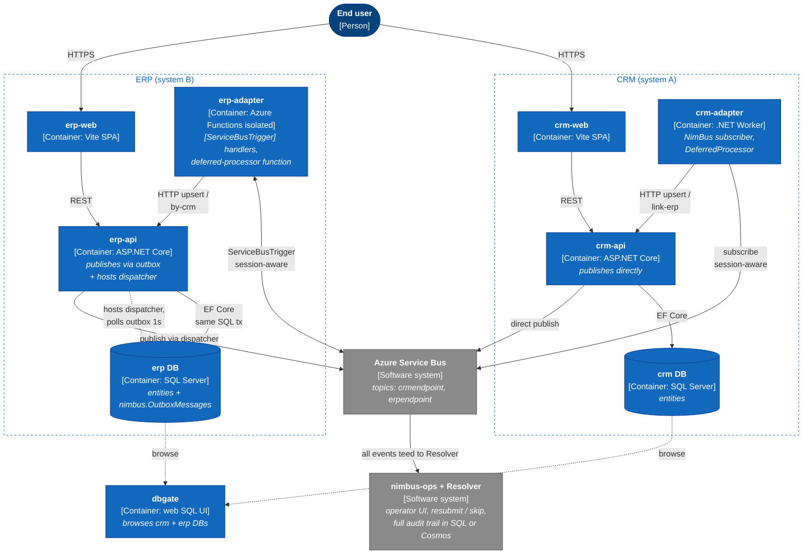
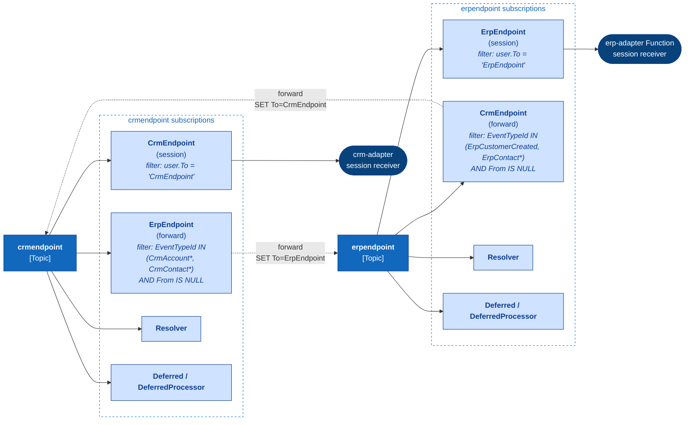
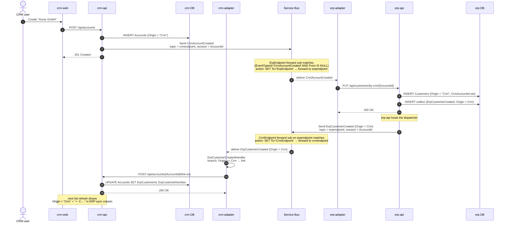
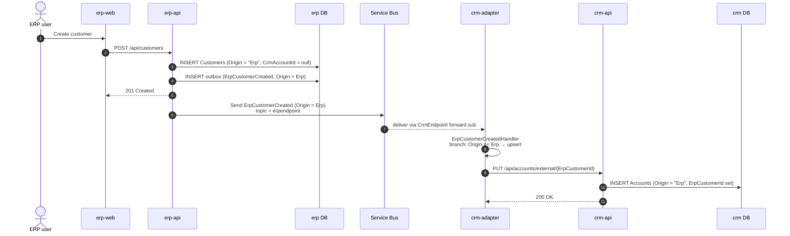
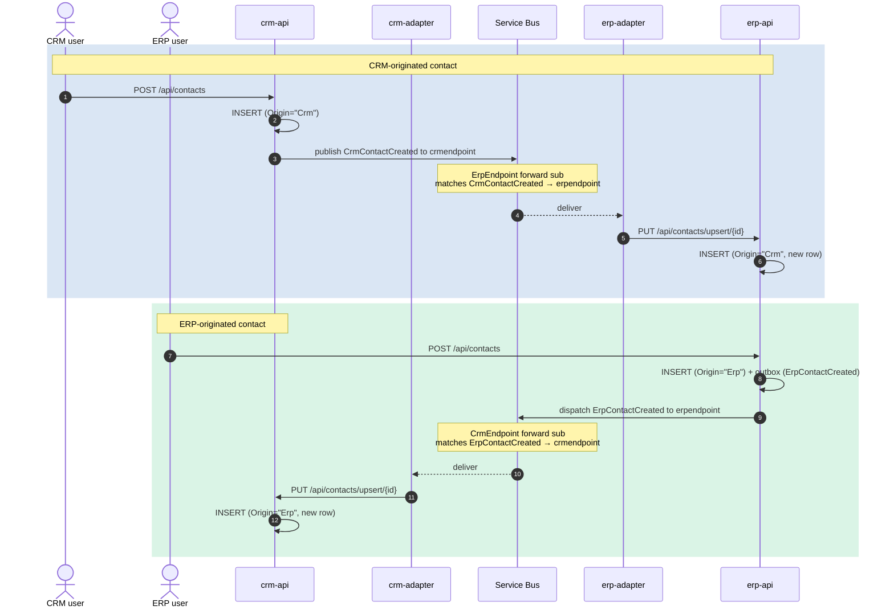
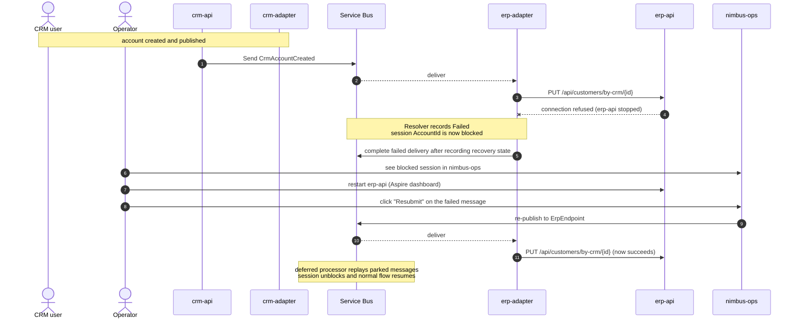
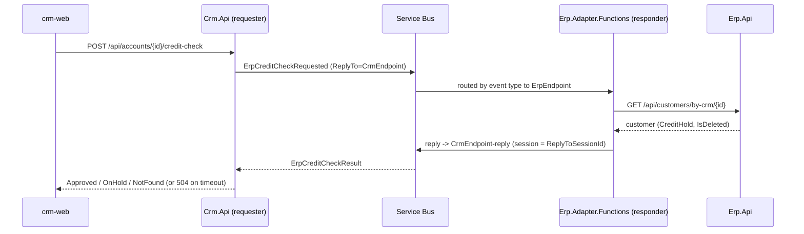

# CRM + ERP Integration Demo

A two-system NimBus demo showing how a CRM and an ERP exchange domain events over Azure Service Bus, each with its own web UI, REST API, database, and adapter — and each adapter using a **different hosting model** (Container/BackgroundService vs. Azure Functions).

## Architecture



## What this demo showcases

- **Direct publishing from CRM** — `Crm.Api` publishes CRM-originated events directly to Service Bus, keeping the CRM adapter focused on inbound ERP events.
- **Transactional outbox on ERP** — `Erp.Api` stages ERP-originated events in its SQL outbox and hosts the dispatcher, so the ERP side is the single sample that demonstrates the outbox pattern.
- **Domain event mapping** — the adapter maps DB entities to clean contract events (`CrmAccountCreated`, `ErpCustomerCreated`, ...) — published applications don't see DB schemas.
- **Origin-prefixed event names** — every event has exactly one producer (`CrmAccountCreated` is only published by CRM, `ErpCustomerCreated` only by ERP). The single-producer convention matches the platform's main catalog and structurally prevents cross-topic forwarding loops.
- **Receiving adapter calls the target REST API** — typed `HttpClient` per system; handlers are idempotent (upsert keyed on the originator's id).
- **Two hosting models, identical handlers** — same `IEventHandler<T>` works in a worker container (CRM) and in Azure Functions (ERP). Demonstrates that hosting is a deployment concern, not a code concern.
- **Session-based ordering** — `[SessionKey(nameof(AccountId))]` keeps the round-trip `CrmAccountCreated → ErpCustomerCreated → link-erp` ordered for each account.
- **Operator surface** — reuses the existing `NimBus.WebApp` + Resolver from the main repo for full audit trail and resubmit/skip.
- **Inbox deduplication on CRM** — `Crm.Adapter` opts into platform-level dedup (`UseInbox`, SQL store in the crm DB); redelivery of the same broker `MessageId` is skipped as `DuplicateDetected`, contrasting with ERP's application-level idempotent upserts. Operator resubmit uses a new message identity.
- **Request/reply (synchronous credit check)** — CRM asks ERP for a customer's credit standing via `PublisherClient.Request` and gets a typed answer back over the `CrmEndpoint-reply` session subscription.
- **Commands (imperative, exactly one consumer)** — `PlaceCustomerOnCreditHold : Command` is fire-and-forget with a single declared consumer (`ErpEndpoint`); platform validation fails provisioning if anyone adds a second consumer (ADR-014).

## Domains in v1

| Direction       | Event                  | Receiving action                        |
|-----------------|------------------------|-----------------------------------------|
| CRM → ERP       | `CrmAccountCreated`    | `PUT /api/customers/by-crm/{id}`        |
| CRM → ERP       | `CrmAccountUpdated`    | `PUT /api/customers/by-crm/{id}`        |
| ERP → CRM (ack) | `ErpCustomerCreated`   | `POST /api/accounts/{id}/link-erp` (Origin=Crm) or `PUT /api/accounts/external/{erpId}` (Origin=Erp) |
| CRM → ERP       | `CrmContactCreated`    | `PUT /api/contacts/upsert/{id}`         |
| CRM → ERP       | `CrmContactUpdated`    | `PUT /api/contacts/upsert/{id}`         |
| ERP → CRM       | `ErpContactCreated`    | `PUT /api/contacts/upsert/{id}`         |
| ERP → CRM       | `ErpContactUpdated`    | `PUT /api/contacts/upsert/{id}`         |

## Message flows

### Service Bus topology — how events cross between topics

The provisioner (`CrmErpDemo.Provisioner`) creates one topic per endpoint and one **forwarding subscription** per cross-system consumer. Each forwarding rule is filtered on `EventTypeId AND user.From IS NULL` so the rule fires only on **original publishes**, never on already-forwarded copies — this is what prevents loops.



### Flow 1 — CRM → ERP → CRM round-trip (account creation)

The headline scenario. Demonstrates direct CRM publishing, ERP-side transactional outbox, cross-topic forwarding, the `Origin` discriminator on `ErpCustomerCreated`, and the back-fill of the ERP customer id onto the CRM account row.



### Flow 2 — ERP-originated customer (one-way)

User creates a customer directly in `erp-web`. ERP publishes once; CRM receives it and upserts a fresh account. No round-trip ack is needed because there's no pre-existing CRM record to link.



### Flow 3 — Bidirectional contacts (no loop)

Either system can originate a contact. Origin-prefixed event types (`CrmContactCreated` vs `ErpContactCreated`) make it structurally impossible for an event to round-trip back to its own publisher — each event has exactly one producer.



### Flow 4 — Failure + resubmit (operator path)

When an ordinary downstream handler call fails, NimBus records **Failed** and **blocks the session** so subsequent events for the same entity wait. Automatic NimBus retries require an explicit retry policy; broker MaxDeliveryCount applies to unsettled redeliveries. The operator resubmits via `nimbus-ops`, which re-publishes the failed message; the deferred-processor subscription then drains any messages parked behind it.



## Suggested v2 domains

Ranked by demo value:

1. **Sales Orders (CRM → ERP)** — multi-step saga (`OrderPlaced → ReservationMade → InvoiceCreated`) on a shared `OrderId` session. Best showcase of session-ordered multi-hop flow.
2. **Products (ERP → CRM catalog sync)** — fan-out to multiple subscribers (CRM + Analytics).
3. **Inventory levels (ERP → CRM)** — high-frequency updates per SKU; demonstrates per-key ordering without head-of-line blocking.

Quotes, Price Lists, Invoices, Payments, Purchase Orders are subsets of the above or distract with payment-gateway plumbing.

## Repo layout

```
samples/CrmErpDemo/
  CrmErpDemo.AppHost/        Aspire host (SQL Server + DbGate + everything below)
  CrmErpDemo.Contracts/      Shared events + endpoints + CrmErpPlatformConfiguration
  CrmErpDemo.Provisioner/    Code-first SB topology (CrmEndpoint, ErpEndpoint)
  Crm.Api/                   ASP.NET Core minimal API + EF Core SQL Server
  Crm.Adapter/               Worker (BackgroundService) subscriber
  Crm.Web/                   React + Vite + TS + Tailwind SPA
  Erp.Api/                   ASP.NET Core minimal API + EF Core; hosts ERP outbox dispatcher
  Erp.Adapter.Functions/     Azure Functions isolated worker
  Erp.Web/                   React + Vite + TS + Tailwind SPA
```

## Prerequisites

- .NET 10 SDK
- Node.js 22+ (for the SPAs)
- Docker (for the Aspire-managed SQL Server container)
- The NimBus Service Bus emulator is enabled by default; no Azure account is required. For a real namespace, set `NIMBUS_SB_EMULATOR=false` and supply `ConnectionStrings:servicebus` in this AppHost's user secrets.
- Azure Cosmos DB connection string only when running with `--StorageProvider cosmos` (default is SQL Server, no Cosmos required)

## Storage provider

NimBus's message store (audit trail, resolver state, blocked sessions, metrics) runs against **SQL Server by default**, in a database named `nimbus` on the same Aspire-managed SQL Server container that already hosts `crm` and `erp`. No Azure connection strings are needed with the default emulator.

Cosmos is an alternative — supply `ConnectionStrings:cosmos` as a user secret and pass `--StorageProvider cosmos` to the AppHost. The AppHost reads the flag at `samples/CrmErpDemo/CrmErpDemo.AppHost/Program.cs:7-11`; the same value is bridged to the Resolver and `nimbus-ops` WebApp via `NimBus__StorageProvider` so they call the matching `AddSqlServerMessageStore()` / `AddCosmosDbMessageStore()` registration.

The CRM and ERP business databases are always SQL Server regardless of the message-store choice. Only ERP uses the `nimbus.OutboxMessages` outbox table.

## Running locally — SQL Server (default)

```bash
# From the repository root; requires a running container runtime.
# Install SPA dependencies (first run only)
npm --prefix samples/CrmErpDemo/Crm.Web install
npm --prefix samples/CrmErpDemo/Erp.Web install

# Run the demo (emulator and SQL Server are the defaults)
aspire run --apphost samples/CrmErpDemo/CrmErpDemo.AppHost/CrmErpDemo.AppHost.csproj
```

Alternatively, run `aspire run` from `samples/CrmErpDemo`. The local
`aspire.config.json` selects this demo instead of the repository's default NimBus
AppHost. Its HTTPS dashboard is at `https://localhost:17080`; use the login link
printed by Aspire, which includes the token for the current run.

The Aspire dashboard opens automatically. Wait for `provisioner` to complete, then everything else turns green. On first start the SQL Server provider's DbUp migrations create the `nimbus` schema (`Messages`, `UnresolvedEvents`, `MessageAudits`, `EndpointSubscriptions`, `EndpointMetadata`, `Heartbeats`, `BlockedMessages`, `InvalidMessages` + metrics views). DbGate is on the dashboard if you want to browse them.

To be explicit about the provider:

```bash
aspire run --apphost samples/CrmErpDemo/CrmErpDemo.AppHost/CrmErpDemo.AppHost.csproj -- --StorageProvider sqlserver
```

## Running locally — Cosmos DB

```bash
# Add the Cosmos secret; Service Bus still uses the emulator by default
dotnet user-secrets --project samples/CrmErpDemo/CrmErpDemo.AppHost set ConnectionStrings:cosmos "AccountEndpoint=https://...;AccountKey=..."

# Run with the cosmos flag
aspire run --apphost samples/CrmErpDemo/CrmErpDemo.AppHost/CrmErpDemo.AppHost.csproj -- --StorageProvider cosmos
```

In Cosmos mode Aspire skips provisioning the `nimbus` SQL database; the Resolver and WebApp call `AddCosmosDbMessageStore()` instead.

## Deploy to Azure

`aspire deploy` publishes the demo to Azure Container Apps in a resource group of its own. The AppHost's publish mode replaces the local-only pieces. Running it locally is unchanged.

| Local (`aspire run`) | Azure (`aspire deploy`) |
|---|---|
| NimBus Service Bus emulator | Azure Service Bus (Standard), local auth disabled; every app connects with its managed identity |
| SQL Server container + DbGate | Azure SQL (`crm`, `erp`, `nimbus`), Entra-only; each app's identity gets `db_owner` |
| Vite dev servers for crm-web / erp-web | `crm-api` and `erp-api` serve the built UIs from `wwwroot` |
| Local-dev auth bypass on nimbus-ops | NimBus Identity sign-in with a bootstrap admin |
| crm-web and erp-web are anonymous | crm-web and erp-web require sign-in with the nimbus-ops accounts; the adapters present a generated service key |
| Provisioner runs before the subscribers | Provisioner is a manually started Container Apps job |
| enrichment-agent signs in through the local-dev bypass | enrichment-agent signs in with an agent API key issued in nimbus-ops (Spec 039) |

Only `crm-api`, `erp-api` and `nimbus-ops` are public. Everything else is internal to the Container Apps environment. The Aspire dashboard URL is printed at the end of the deploy.

CRM and ERP use the nimbus-ops user store, so the same email and password work on all three apps. Users are managed in nimbus-ops, and any signed-in user gets in; there are no roles inside CRM and ERP. Each app is on its own `*.azurecontainerapps.io` host and that domain is a public suffix, so the apps can't share a cookie: you sign in to each once. The health probes (`/health`, `/alive`, `/ready`) and the static UI bundles stay public.

> [!WARNING]
> Every signed-in user can use the whole demo, including `DELETE /api/admin/data`. Use fictional data only, and tear the environment down when you are done.

### Prerequisites

- Everything in [Prerequisites](#prerequisites), plus the [Aspire CLI](https://aspire.dev/get-started/install-cli/), Azure CLI (`az login`) and Docker (the images are built locally and pushed to the environment's registry).
- Owner, or Contributor + Role Based Access Control Administrator, on the subscription. The deploy creates role assignments.
- A region with Container Apps and Azure SQL capacity. `swedencentral` is known to work.

### Deploy

Deploy settings and parameters are environment variables on the `aspire deploy` process. The AppHost's user secrets are not read, because deploy runs in the Production environment. `ops-admin-email` and `ops-admin-password` are the nimbus-ops bootstrap admin. It is created on the first start against an empty user store, so changing them later has no effect.

```bash
Azure__SubscriptionId=<subscription-id> Azure__Location=swedencentral Azure__ResourceGroup=rg-crmerp-demo Parameters__ops_admin_email=admin@example.com Parameters__ops_admin_password='<a strong password>' aspire deploy --apphost samples/CrmErpDemo/CrmErpDemo.AppHost/CrmErpDemo.AppHost.csproj
```

If your account can see more than one tenant, also set `Azure__TenantId`. The first deploy takes about 20 minutes. `flow-webhook-key` (the shared key for the Resolver's realtime Flow updates) and `demo-service-key` (the adapters' key for the CRM and ERP APIs) are generated and kept in the deployment state. Redeploying the same command updates the apps in place.

Then create the Service Bus topology by starting the provisioner job once. Run it again after a deploy that changes the event catalog:

```bash
az containerapp job start -g rg-crmerp-demo -n provisioner
```

```bash
az containerapp job execution list -g rg-crmerp-demo -n provisioner --query "[0].properties.status" -o tsv
```

Until the job has run, the subscribers log "messaging entity could not be found" errors. They keep retrying, and the demo starts working once the job reports `Succeeded`.

List the public URLs with:

```bash
az containerapp list -g rg-crmerp-demo --query "[?properties.configuration.ingress.external].properties.configuration.ingress.fqdn" -o tsv
```

### Give the enrichment agent its key

nimbus-ops requires sign-in in Azure, so the enrichment agent needs an agent API key. The key can only be issued once nimbus-ops is running, so the first deploy has none. Until it does, the agent logs 401s and the Agent Zone holds new CRM contacts as Pending.

1. Sign in to nimbus-ops as the bootstrap admin. Open **Settings → Agent keys** and issue a key for agent id `enrichment-agent`. Copy it: it is shown once.
2. Redeploy with the key added to the same command, as `Parameters__enrichment_agent_key='<the key>'`. Pass it on every later deploy too, or the agent loses it. To use Claude for classification, also add `Parameters__anthropic_api_key`; without it the agent uses its deterministic classifier.
3. The held contacts are enriched within a minute. In **Settings → Agent keys** the key now shows when it was last used.

### Smoke test

1. Open the `crm-api` URL from the deploy output. It redirects to the sign-in page. Sign in with the bootstrap admin; crm-web opens and shows "Signed in as" in its header. Create an account.
2. Open the `erp-api` URL (erp-web) and sign in the same way. The customer appears, and crm-web shows its ERP customer number. The adapters reached both APIs with the service key.
3. Open the `nimbus-ops` URL and sign in with the bootstrap admin. The account's events are Completed under **Endpoints**, and **Flow** animates new traffic.
4. A PartnerPortal lead arrives in crm-web's contacts about every 45 seconds.
5. A new contact is enriched by the agent. Its hand-off on **AgentZoneEndpoint** is Completed, and the audit names `enrichment-agent`.

### Tear down

```bash
aspire destroy --apphost samples/CrmErpDemo/CrmErpDemo.AppHost/CrmErpDemo.AppHost.csproj
```

`aspire destroy` deletes the whole resource group. While it runs, the environment costs roughly the Service Bus Standard base charge, a Basic container registry and Container Apps consumption for the always-on apps. Azure SQL uses the serverless free offer.

## End-to-end happy path

1. Open **crm-web** from the Aspire dashboard.
2. Create an account "Acme GmbH" (DE).
3. In the Aspire logs you should see, in order:
   - `crm-api` writes the account and publishes `CrmAccountCreated` directly to Service Bus
   - `erp-adapter` Function fires on `ErpEndpoint`
   - `erp-api` receives `PUT /api/customers/by-crm/{id}` and writes the customer + outbox row
   - `erp-api`'s outbox dispatcher publishes `ErpCustomerCreated`
   - `crm-adapter` handler `POST`s `/api/accounts/{id}/link-erp` to populate `ErpCustomerId`
4. Open **erp-web** → the new customer is visible.
5. Refresh **crm-web** → the account row now shows the ERP customer number (`✓ C-...`).
6. Open **nimbus-ops** → the audit trail (Resolver) shows both events on the same `AccountId` session.
7. Open **dbgate** (web SQL UI) → connect "Aspire SQL Server" auto-loads → inspect `erp.[nimbus].[OutboxMessages]` to see ERP outbox rows being written and dispatched.

## Failure path (to demonstrate resubmit)

1. In the Aspire dashboard, **stop `erp-api`**.
2. Create another account in **crm-web**.
3. The `erp-adapter` Function fires and the HTTP call to `erp-api` fails. The adapter registers no retry policy, so NimBus records the message as **Failed** without retrying it and **blocks the session**.
4. **nimbus-ops** shows the blocked session.
5. Restart `erp-api` from the Aspire dashboard.
6. From **nimbus-ops**, resubmit the failed message → flow completes; the link-erp callback updates the account.

For the full classification of error types in an adapter (transient redelivery, retry, immediate dead-letter, validation rejection) and how each path is recorded by the Resolver, see [`docs/error-handling.md`](../../docs/error-handling.md).

## Showcase: PendingHandoff (async ERP imports)

NimBus's PendingHandoff feature ([ADR-012](../../docs/adr/012-pending-handoff.md)) lets a subscriber handler signal "work is in flight on an external system" via `ctx.MarkPendingHandoff(reason, externalJobId, expectedBy)` and return normally — the inbound message is settled, the session blocks for siblings, the audit row reads `Pending` + `PendingSubStatus = "Handoff"`, and settlement happens later via `IHandoffClient.CompleteAsync` / `FailAsync` without re-invoking the user handler. This demo wires the feature onto the ERP adapter's `CrmAccountCreated` handler so the lifecycle (Pending badge, deferred siblings, completion replay, failure + operator Skip) is visible end-to-end in the AppHost.

The control surface is in **erp-web → Admin**: a toggle plus duration and failure-rate sliders. `Erp.Api/HandoffMode/HandoffJobBackgroundService` simulates the external import, draining expired jobs once a second and rolling against the configured failure rate; on success it applies the upsert and calls `IHandoffClient.CompleteAsync`, on failure it calls `IHandoffClient.FailAsync` with one of a small set of canned `DMF rejected: ...` errors.

### Manual smoke flow

1. AppHost up → open **erp-web** → Admin → flip handoff mode ON, set ~30 s, 0% failure.
2. Open **crm-web** → create account "Acme".
3. Open **nimbus-ops** (the operator UI) → navigate to `ErpEndpoint` → see the `CrmAccountCreated` row marked **Pending** with the **Awaiting external** badge. Click it → the detail page shows `HandoffReason`, `ExternalJobId`, `ExpectedBy`.
4. Back in **crm-web** → update "Acme" twice in quick succession.
5. **nimbus-ops** → both updates show **Deferred** (queued behind the in-flight create on the same session).
6. Wait. After ~30 s the create row flips to **Completed**, the deferred updates replay in FIFO order (also Completed), and the ERP customer in **erp-web** reflects the latest update.
7. Re-flip Erp.Web admin: failure rate = 100%. Create another account.
8. **nimbus-ops** → after ~30 s the row is **Failed** with `ErrorContent.ErrorText` matching one of the canned `DMF rejected: ...` strings verbatim. Click **Skip** → audit row flips to **Skipped**, session unblocks.

### Automated coverage

The lifecycle is exercised end-to-end by the Playwright suite in [`e2e/`](e2e/):

- [`e2e/tests/04-pending-handoff-success.spec.ts`](e2e/tests/04-pending-handoff-success.spec.ts) — create handoff + 2 sibling updates → create reaches `Pending+Handoff`, updates Defer, all complete on settlement.
- [`e2e/tests/05-pending-handoff-failure.spec.ts`](e2e/tests/05-pending-handoff-failure.spec.ts) — handoff fails with a `DMF rejected:` error → operator Skip flips the row to `Skipped`.

## Showcase: Notification alerts (failure → webhook → operator alert)

NimBus's [notifications extension](../../docs/notifications.md) (`NimBus.Extensions.Notifications`)
turns message-lifecycle events into outbound alerts over production channels (Webhook, Teams,
Email) with per-channel severity routing, rate limiting and dedup. This demo wires the **Webhook**
channel onto the ERP adapter so failures are surfaced as live operator alerts — no Teams/SendGrid
account required.

The loop is fully local:

```
erp-web (Error mode / Service mode toggle)
   └─▶ erp-adapter handler fails  →  NimBus lifecycle: Failed / DeadLettered / SessionBlocked
        └─▶ WebhookChannel POSTs a JSON alert  →  erp-api  /api/webhooks/notifications
             └─▶ AlertsState (last 50, in-memory)
                  └─▶ erp-web "Notification alerts" panel polls /api/admin/alerts every 3s
```

- **Emit** — `Erp.Adapter.Functions/Program.cs` registers `AddNimBusNotifications(...)` with a single
  `AddWebhook` channel (`MinSeverity = Warning`, so `Error` + `Critical` pass and `Information`
  noise is skipped) and a JSON `Template`. The webhook URL reuses the same `erp-api` base address
  the adapter already calls.
- **Receive** — `Erp.Api/Endpoints/AlertsEndpoints.cs` exposes `POST /api/webhooks/notifications`
  (the sink), `GET /api/admin/alerts`, and `DELETE /api/admin/alerts`, backed by the in-memory
  `Erp.Api/AlertsState.cs` (mirrors the other demo state singletons; non-persistent).
- **Display** — `Erp.Web/src/components/admin/alerts-panel.tsx` renders newest-first,
  severity-colored cards (Critical → rose, Error → amber).

> The receiver is unauthenticated by design — it's a local demo sink, and the `WebhookChannel`
> sends no auth header. Don't copy this receiver verbatim into production.

### Manual smoke flow

1. AppHost up → open **erp-web**.
2. Open **crm-web** → create an account (e.g. "Acme GmbH") to start CRM → ERP traffic.
3. In **erp-web**, flip **Error mode** ON (header toggle): every inbound ERP handler now throws.
   The dropdown next to it picks *which* failure is simulated (see [Failure reasons](#failure-reasons-integration-intelligence-showcase)).
4. Within a few seconds the **Notification alerts** panel shows an **Error** alert
   ("Message failed: …"). Handler failures are not retried: the message is recorded as Failed and
   its session blocks, so the next message on that session (for example an edit to the same
   account) raises a **Critical** **session blocked** alert.
   Flipping **Service mode** ON instead rejects inbound messages in middleware, which dead-letters
   them immediately: each produces an **Error** alert and a **Critical** **dead-lettered** alert.
5. Turn the toggles OFF to stop new alerts; click **Clear** to empty the panel.

### Failure reasons (Integration Intelligence showcase)

Error mode throws a *selectable* failure so the NimBus WebApp's
[Integration Intelligence](../../docs/integration-intelligence.md) card has something realistic to
classify. NimBus stores only the exception's type name and message as failure evidence (no stack
trace), so each reason's message carries the cues a real failure of that kind would: status codes,
identifiers, the downstream system, and what would have to change.

| Dropdown entry | Throws | NimBus outcome | Designed to classify as |
|---|---|---|---|
| Generic handler exception (default) | `HandlerErrorModeException` | Failed | `unknown` — the control case with no usable evidence |
| Downstream timeout (transient) | `TimeoutException` 503 + connection reset | Failed | `transient_dependency` |
| Expired credentials (auth/config) | `UnauthorizedAccessException` 401, expired secret | Failed | `authentication_configuration` |
| Schema mismatch (contract) | `FormatException` on `CountryCode` | Failed | `contract_schema` |
| Customer closed (business rule) | `InvalidOperationException` rule ERP-CUST-017 | Failed | `business_rule` |
| Customer not found (missing reference) | `KeyNotFoundException` for the CRM account | Failed | `missing_reference_data` |
| Null reference (application defect) | `NullReferenceException` in the mapper | Failed | `application_defect` |

The catalog lives in `CrmErpDemo.Contracts/Demo/ErpFailureReasons.cs` and is shared by `Erp.Api`
(stores and validates the selection, `GET/PUT /api/admin/error-mode` with `reason`,
`GET /api/admin/error-mode/reasons`), `Erp.Adapter.Functions` (`ErrorModeGuard` throws the
matching exception from every handler) and the erp-web dropdown, so the three cannot drift.

To run the showcase: enable Integration Intelligence in the WebApp (user secrets, see the guide),
pick a reason, flip error mode ON, create or edit a CRM account or contact, open the failed
message in the NimBus WebApp and click **Analyze failure**. Switch reasons and repeat to compare
categories and guidance. `PUT /api/admin/error-mode` still accepts a bare `{ "enabled": true }`,
so the e2e suite and the demo film keep the generic failure.

## Showcase: Circuit breaker (outage → pause → probe → recover)

NimBus's [endpoint circuit breaker](../../docs/circuit-breaker.md) pauses a subscriber's
receivers when retry-eligible failures indicate a distressed downstream dependency — messages
wait untouched on the subscription instead of burning retry budgets into the dead-letter queue.
This demo wires it onto **crm-adapter** (the SDK-hosted worker; Functions hosts cannot pause)
with demo-tuned thresholds so the whole loop runs inside a minute.

The loop is fully local:

```
crm-web ("CRM API outage" toggle)
   └─▶ crm-adapter's HTTP client returns synthetic 503s  →  every CrmEndpoint handler fails
        └─▶ failure rate ≥ 50% over 5+ outcomes  →  circuit OPENS  →  both receivers pause
             └─▶ 20s break  →  HALF-OPEN probes at 1 session  →  2 successes  →  CLOSED
                  └─▶ CircuitStateReporter POSTs each transition  →  crm-api  /api/webhooks/circuit-state
                       └─▶ crm-web "Circuit breaker" panel polls /api/admin/circuit-state every 3s
```

- **Fail** — `Crm.Api/ErrorModeState.cs` + `/api/admin/error-mode` (mirrors the ERP toggles);
  `Crm.Adapter/Clients/CrmOutageSimulationHandler.cs` injects the 503s *below* the handlers, so
  failures take the authentic `CrmApiClient` path and count toward the breaker.
- **Break** — `Crm.Adapter/Program.cs` opts in with `WithCircuitBreaker(...)`, thresholds from the
  `Crm:CircuitBreaker` appsettings section (5 outcomes / 50% / 60s window / 20s break / 2 probes).
  One breaker pauses both receivers — CrmEndpoint *and* the PartnerInbound ingress.
- **Display** — `Crm.Adapter/Observability/CircuitStateReporter.cs` (a default-implemented
  `IMessageLifecycleObserver`) pushes transitions to `Crm.Api/CircuitStateStore.cs`;
  `Crm.Web/src/components/admin/circuit-breaker-panel.tsx` shows Closed / Open / Half-open live.
  The `nimbus.circuit_breaker.state` gauge also lands in the Aspire dashboard's Metrics tab.

### Manual smoke flow

1. AppHost up → open **crm-web** → the Circuit breaker panel reads **Closed**.
2. Click **Simulate** (or create accounts by hand) to drive steady CRM → ERP → CRM traffic.
3. Flip **CRM API outage: ON**. Handlers fail; within ~15–30 s the panel flips to **Open** —
   crm-adapter's log shows "Pausing NimBus receiver …", and **nimbus-ops** shows the few failed
   sessions from before the pause (no flood: the receiver stopped consuming).
4. Flip the outage **OFF**. After the 20 s break the panel shows **Half-open** (probing at one
   session), then **Closed**; traffic completes normally again in nimbus-ops.

### Automated coverage

- [`e2e/tests/11-circuit-breaker-recovery.spec.ts`](e2e/tests/11-circuit-breaker-recovery.spec.ts) —
  outage on → 6 failing sessions open the circuit (asserted via `/api/admin/circuit-state`) →
  outage off → probe traffic closes it → a fresh event completes on CrmEndpoint.

## Showcase: CloudEvents partner interop (external system, zero NimBus)

NimBus's [CloudEvents 1.0 interoperability](../../docs/cloudevents.md) ([ADR-013](../../docs/adr/013-cloudevents-interoperability.md)) is demonstrated in both directions by **PartnerPortal** — a simulated external third-party system that deliberately references only `Azure.Messaging.ServiceBus` (zero NimBus packages). A visual guide with sequence diagrams and wire-format examples is in [docs/partner-interop.md](docs/partner-interop.md):

```
PartnerPortal (no NimBus)
   │  INBOUND: raw CloudEvents (binary mode, ce-* application properties,
   │           type = com.partnerportal.crm.PartnerLeadSubmitted, SessionId = LeadId)
   ▼
PartnerInbound topic ─ CrmEndpoint subscription (session-required, catch-all)
   ▼
crm-adapter (AutoDetect subscriber, second receiver)
   └─▶ PartnerLeadSubmittedHandler → Crm.Api upsert → contact appears in crm-web
       with a violet "Partner" origin badge

erp-api publisher + UseCloudEvents(Binary, source urn:crmerpdemo:erp)
   ▼  (envelope survives the SQL outbox — Message.CloudEvent is serialized into Payload)
ErpEndpoint topic ─ PartnerPortalCapture subscription
   (rule: user.MessageType = 'EventRequest' AND user.From IS NULL)
   ▼
   OUTBOUND: PartnerPortal logs the raw cloudEvents:* properties + domain JSON
```

Key mechanics on display:

- **Inbound routing without NimBus properties** — the partner stamps no `user.*` routing
  properties; `MessageContext` synthesizes `To`/`EventTypeId`/`From`/`EventId` from the
  CloudEvent at consume time. The default type mapping takes the last dot-segment of the
  CloudEvents `type` (`com.partnerportal.crm.PartnerLeadSubmitted` → `PartnerLeadSubmitted`),
  so no subscriber configuration is needed.
- **Alternate prefix** — the partner uses `ce-*` properties (not NimBus's own `cloudEvents:*`)
  to prove the reader's `AcceptedPrefixes` handle non-Microsoft producers.
- **AutoDetect** — crm-adapter and dataplatform-adapter handle native and CloudEvents traffic
  on the same subscription; native messages are processed byte-identically.
- **Outbox survival** — ERP events flow business-transactionally through
  `nimbus.OutboxMessages` and are still emitted as CloudEvents by the dispatcher.
- **AsyncAPI** — `ErpEndpoint` implements `ICloudEventsAware`, so the nimbus-ops Topology
  AsyncAPI export carries the `x-cloudevents` channel extension + `CloudEventsMessageHeaders`
  schema for the `erpendpoint` channel.

> Resolver caveat: the Resolver ingests forwarded CloudEvents copies natively, so the
> *Pending* audit row of a CloudEvents message shows an empty payload view; the
> Completed/Failed rows carry the full content plus the CloudEvent identity
> (`CloudEventId/Source/Type/Subject`) in the store.

### Manual smoke flow

1. AppHost up → **partner-portal** logs a published lead every 45 s
   (`PARTNER_LEAD_INTERVAL_SECONDS` to change).
2. **crm-adapter** logs `PartnerLeadSubmittedHandler` with the CloudEvent id/source/type;
   open **crm-web** → Contacts → the lead appears with a violet **Partner** badge.
3. Open **erp-web** → create a customer (or create an account in **crm-web** and let the
   round-trip produce `ErpCustomerCreated`) → **partner-portal** logs the raw
   `cloudEvents:*` properties and domain JSON of the ERP event.
4. Dead-letter demo: set `PARTNER_SEND_INVALID=true` on partner-portal and restart it →
   it sends one CloudEvent missing `ce-source`; crm-adapter rejects it with
   `InvalidCloudEventException` and the message lands in the
   `PartnerInbound/CrmEndpoint` dead-letter queue.

## Showcase: Inbox deduplication (CrmEndpoint)

NimBus fan-out forwards copies of one published message — with the same broker
`MessageId` — so broker redelivery can hand a subscriber the same
message twice. `Crm.Adapter` opts into the platform-level inbox so a second delivery
of an already-processed `MessageId` is skipped instead of re-invoking the handler:

```csharp
builder.Services.AddNimBusSqlServerInbox(crmDbConnectionString);   // [nimbus].[InboxMessages] in the crm DB

sub.UseInbox(options =>
{
    options.DeduplicationStore = InboxStore.SqlServer;
    options.RetentionPeriod = TimeSpan.FromDays(2);
    options.CleanupInterval = TimeSpan.FromMinutes(15);
});
```

The demo deliberately contrasts two idempotency strategies: the CRM side uses
**platform-level** dedup (handlers never see the duplicate), while the ERP side keeps
**application-level** idempotency (upserts keyed on `CrmAccountId` — duplicates run but
converge). The crm business DB doubling as the dedup store mirrors the erp DB hosting
the outbox table: `[crm].[nimbus].[InboxMessages]` vs `[erp].[nimbus].[OutboxMessages]`,
both browsable in DbGate.

### Manual smoke flow

1. AppHost up → create a customer in **erp-web** → wait until the account appears in **crm-web**.
2. Open **nimbus-ops** → CrmEndpoint → find the Completed `ErpCustomerCreated` event → **Resubmit** it.
3. Operator resubmit allocates a new `MessageId`, invokes the handler, and completes.
   The idempotent business upsert leaves the CRM audit unchanged. The automated
   inbox test below republishes the original broker identity separately and asserts
   `DuplicateDetected`, no second handler invocation, and no new business audit row.
4. DbGate → crm DB → `SELECT * FROM nimbus.InboxMessages` shows one row per processed message.

### Automated coverage

`tests/NimBus.EndToEnd.Tests/InboxEndToEndTests.cs` (core) and `e2e/tests/08-inbox-dedup.spec.ts` (demo).

## Showcase: Request/reply (synchronous ERP credit check)

The account page in **crm-web** has a **Run ERP credit check** button — a synchronous
question ("can this customer buy on credit *right now*?") that doesn't fit fire-and-forget
pub/sub. `Crm.Api` uses the request/reply pattern:



The request is a normal audited NimBus event; the **reply** is a raw session message on
the auto-provisioned `CrmEndpoint-reply` subscription — no audit row, 5-minute TTL.
A responder-side exception comes back as `RequestReplyException` (fail-fast) instead of
a timeout. Note the request shares the account's `[SessionKey]`, so a blocked session
for that account surfaces as a visible timeout.

### Manual smoke flow

1. Create an account in **crm-web**, wait for the ERP sync, open the account → **Run ERP credit check** → green **Approved** badge with the ERP customer number, typically well under a second.
2. Timeout path: open **erp-web** → Admin → enable **maintenance mode** → run the check again → the request is rejected on the ERP side and the button reports the 10 s timeout. Disable maintenance mode afterwards.

### Automated coverage

`tests/NimBus.SDK.Tests/RequestJsonHandlerTests.cs` + `PublisherClientRequestTests.cs`,
`tests/NimBus.EndToEnd.Tests/RequestReplyEndToEndTests.cs` (core) and
`e2e/tests/09-request-reply-credit-check.spec.ts` (demo).

## Showcase: Commands (imperative, exactly one consumer)

All 13 domain events are past-tense notifications ("this happened") with any number of
observers. **Place credit hold in ERP** on the crm-web account page sends the demo's one
command — an imperative instruction with exactly one recipient:

```csharp
[SessionKey(nameof(AccountId))]
public class PlaceCustomerOnCreditHold : Command   // <- not Event
{
    public Guid AccountId { get; set; }
    public string? Reason { get; set; }
    ...
}
```

Commands travel exactly like events (same topics, session ordering, Resolver audit); the
difference is contractual: `PlatformValidation.EnsureCommandConsumers` runs at provisioning
time (real provisioner *and* emulator config generation) and fails if a `Command`-derived
type has zero or multiple declared consumers. Add
`Consumes<PlaceCustomerOnCreditHold>()` to a second endpoint and the AppHost refuses to
start — see `tests/CrmErpDemo.AppHost.Tests/CommandCatalogTests.cs`. Rationale: ADR-014.

The handler sets `CreditHold` on the ERP customer and publishes **no** event back — the
hold becomes visible through the ERP UI (amber **Credit hold** badge) and through the next
credit check returning **On hold**, which is also how the two showcases prove each other.

### Manual smoke flow

1. Create an account in **crm-web**, wait for ERP sync, run a credit check → **Approved**.
2. **Place credit hold in ERP** → confirm. **erp-web** → Customers shows the amber **Credit hold** badge (audit trail records the `CreditHold` field change).
3. Run the credit check again → amber **On hold**, `Approved=false`.

### Automated coverage

`tests/NimBus.Core.Tests/PlatformValidationTests.cs` + `tests/CrmErpDemo.AppHost.Tests/CommandCatalogTests.cs` (core/catalog) and `e2e/tests/10-credit-hold-command.spec.ts` (demo).

## Demo video

[`docs/demo-video-script.md`](docs/demo-video-script.md) is the shot-by-shot script
for the ~8-minute product film built on this sample — "the life of one customer
account" — following a single account through the happy path, a failure and
operator resubmit, a slow external handoff, request/reply plus a command, and the
CloudEvents partner.

[`e2e/demo/`](e2e/demo/) records it: a Playwright harness that drives the live
AppHost and writes one `.webm` per act to `e2e/demo-footage/`, plus an ElevenLabs
voice-over that is synthesized up front, paced into the shots as they record, and
mixed onto the footage with ffmpeg afterwards.

```bash
cd e2e
npm run demo:voice   # synthesize the narration (ELEVENLABS_API_KEY in .env.local)
npm run demo         # record the five acts against a live AppHost
npm run demo:mux     # mix voice onto footage, write subtitles
npm run demo:film    # join the acts into one mp4
```

Unlike the regression specs it produces footage rather than a pass/fail signal,
but every caption is gated on an assertion that the claimed state is really on
screen — see [`e2e/demo/README.md`](e2e/demo/README.md).

## Out of scope (v1)

No authn/authz, no multi-tenant, no production deployment scripts, no non-Azure transports, no realistic tax/currency/shipping math, no automated browser tests, no UI i18n, no Sales Orders/Products/Inventory.

## Files to look at

| Concern                                 | File                                                                                       |
|-----------------------------------------|--------------------------------------------------------------------------------------------|
| Domain event contracts                  | `CrmErpDemo.Contracts/Events/*.cs`                                                         |
| Topology (endpoints, consumes/produces) | `CrmErpDemo.Contracts/Endpoints/*.cs` + `CrmErpPlatformConfiguration.cs`                   |
| CRM business event detection            | `Crm.Api/Endpoints/AccountEndpoints.cs` (publish after `SaveChangesAsync`)                 |
| ERP atomic entity + outbox commit       | `Erp.Api/OutboxScope.cs` (shares EF's `SqlConnection`/`SqlTransaction` with `SqlServerOutbox` via `SqlServerOutboxAmbientTransaction`) |
| CRM subscriber handlers                 | `Crm.Adapter/Handlers/*.cs`                                                                |
| ERP Function adapter                    | `Erp.Adapter.Functions/Functions/ErpEndpointFunction.cs` + deferred function                |
| ERP subscriber handlers                 | `Erp.Adapter.Functions/Handlers/*.cs`                                                       |
| Aspire wiring                           | `CrmErpDemo.AppHost/Program.cs`                                                            |
| CloudEvents partner (external, no NimBus) | `PartnerPortal/Program.cs`                                                               |
| CloudEvents inbound handler             | `Crm.Adapter/Handlers/PartnerLeadSubmittedHandler.cs`                                      |
| Inbox dedup wiring                      | `Crm.Adapter/Program.cs` (`AddNimBusSqlServerInbox` + `UseInbox`)                          |
| Request/reply requester + command sender | `Crm.Api/Endpoints/ErpIntegrationEndpoints.cs`                                            |
| Request/reply responder                 | `Erp.Adapter.Functions/Handlers/ErpCreditCheckRequestedHandler.cs`                          |
| Command contract + handler              | `CrmErpDemo.Contracts/Commands/PlaceCustomerOnCreditHold.cs` + `Erp.Adapter.Functions/Handlers/PlaceCustomerOnCreditHoldHandler.cs` |
| Command catalog enforcement             | `tests/CrmErpDemo.AppHost.Tests/CommandCatalogTests.cs`                                     |
